# SO-101 ACT data collection and training: architecture guide

This guide describes how the SO-101 ACT pipeline works as of 2026-10-20 (ledger checkpoint CP-3748, branch
`codex/so101-act-data-0917a`): how demonstrations are collected in simulation, how they are processed, sealed and
exported, how a policy is trained and evaluated, and how it is rolled out in closed loop. It replaces the earlier
head-and-wrist guide, which described a tree where nothing had been collected or trained.

The guide is a map, not a log. Run-by-run evidence lives in
`docs/experiments/so101-act-data-experiment-ledger.md` ("the ledger", cited as CP-nnnn). The open to-do list lives
in `docs/experiments/so101-act-optimisation-todos.md` ("the to-do list"). Confirmed designs live in
`docs/superpowers/specs/`.

## How to read this guide

Every statement comes from one of three places, and the text says which when it matters.

| Tag | Meaning |
| --- | --- |
| code | Read in the source of this worktree on 2026-10-20. |
| record | Taken from the ledger, the to-do list, a design document or a run's evidence files. |
| not verified | Could not be checked against code or evidence. Marked inline as "Not verified". |

Several designs are confirmed but not yet implemented. The guide marks each one "planned". The largest is the
logic-versus-runtime parameter split (section 4.1): today most configuration files are still hashed as whole files.

## Contents

1. [Overview and system context](#1-overview-and-system-context)
2. [Component design](#2-component-design)
3. [Workflows](#3-workflows)
4. [Configuration reference](#4-configuration-reference)
5. [Evidence, identities and integrity](#5-evidence-identities-and-integrity)
6. [Performance and optimisation](#6-performance-and-optimisation)
7. [Known issues and current status](#7-known-issues-and-current-status)
8. [Glossary](#8-glossary)
9. [Appendix: smaller commands from the earlier guide](#9-appendix-smaller-commands-from-the-earlier-guide)

---

## 1. Overview and system context

### 1.1 What the pipeline does

A scripted expert, the Teacher, picks a plastic cup and places it at a fixed target in MuJoCo. While it works, a
recorder writes everything the policy will later need: two camera streams, the arm state and the commanded actions,
all on a 10 Hz grid. The recordings are checked, sealed and exported as a training set. An ACT policy (action chunking
transformer, from LeRobot 0.6.1) is trained on that set, scored offline, and finally run in the same simulator in
closed loop to see whether it completes the task.

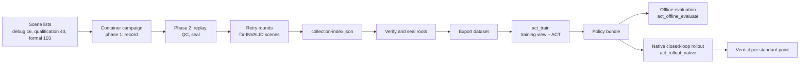

Figure 1. The pipeline from scene list to rollout verdict.

### 1.2 Hosts

Three machines take part. Only ai-station collects data.

| Host | Hardware | Role in this pipeline | Source |
| --- | --- | --- | --- |
| ai-station (Linux) | RTX 5060 Ti 16 GB, 32 threads, 62 GB RAM (read from the host on 2026-10-20) | Collection campaigns, Host gate, export, training, offline evaluation, native rollout, the registered evidence partition | code, record |
| antzb (Linux) | RTX 5080 | Training speed profiling (nsys, ncu), compile and bf16 comparisons. It cannot ssh to ai-station, so results come back as files. | record (`train-profile-20261019/report.md`) |
| macOS (mac-mini) | Apple silicon | Cross-platform verification of the unit-test gates (`ssh mac-mini`). ACT collection is not run there. | record. Not verified: whether the native processor path works on macOS (the two-phase design calls it out of scope for the first delivery). |

Linux hosts with NoteBook FanControl need fans at 100 % before training or collection (section 7.3).

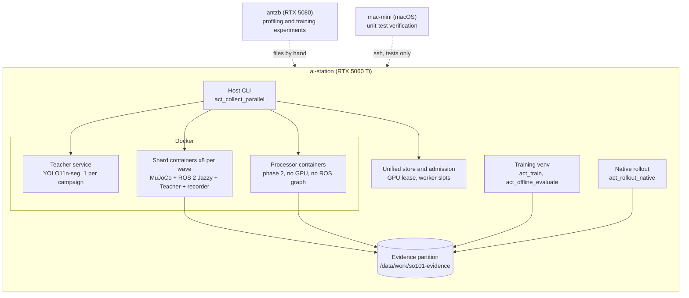

Figure 2. Hosts and processes. Dotted lines are manual hand-offs, not services.

### 1.3 Directory layout

AGENTS.md defines one layout on every host. `W` is `/data/work` on ai-station and `/opt/data/work` on macOS. The
evidence partition holds evidence only; everything that can be rebuilt lives elsewhere.

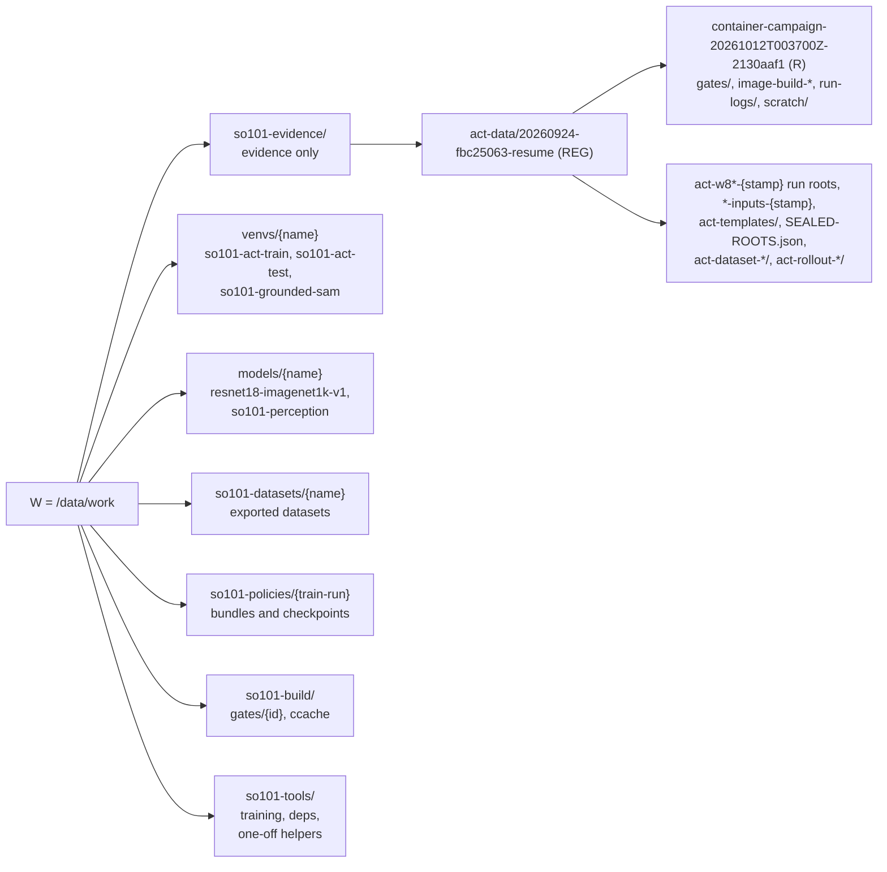

Figure 3. The `W/*` layout and the registered evidence root of this task.

| Path | Holds | Rule |
| --- | --- | --- |
| `W/so101-evidence/` | Run roots, sealed roots, calibration, diagnostics, run logs, gate results, deletion records, per-test scratch | Evidence only. Nothing is deleted without explicit authorisation. |
| `W/venvs/` | Interpreters. `so101-act-train` has torch 2.11.0+cu128 and lerobot 0.6.1. | Recorded by path and pip freeze. |
| `W/models/` | ResNet18 ImageNet weights (`resnet18-f37072fd.pth`), YOLO and Grounded-SAM weights | Recorded by path and sha256. |
| `W/so101-datasets/` | Exports such as `side-wrist-103-20261019T0342Z` (8.0 GB) | Reproducible from a manifest. |
| `W/so101-policies/` | One directory per training run holding `bundle/`, `bundle.state.json`, `bundle.training-view` | Recorded in `training-outputs.json`. |
| `W/so101-build/` | `gates/<id>` build and install trees, ccache | Deletable after the gate and templates that use it are done. |
| `W/so101-tools/` | Only one-off or temporary helpers that are not in git: training launchers, the frozen `deps/`, one-off scripts. The gate, evidence and image tools and the samplers are in the repository under `scripts/`. | Indexed in `W/so101-tools/README.md`. |

Sealed gates `8f8123dcba86` and `a1d3b7b0bbb5` keep their install inside their evidence directory because sealed roots
never move (record: `scripts/gate/README.md`).

### 1.4 Camera rigs

The rig is data, not code. A rig profile (`config/act/rig-v1.yaml`, `config/act/rig-v2.yaml`, loaded by
`act/rig_profile.py`) names the cameras in order, their topics and frame-file keys, whether a head and neck exist, and
the state layout. About twenty places that once hard-coded "head" and "wrist" now read it (design
`2026-10-18-so101-act-camera-rig-v2-design.md`, CONFIRMED).

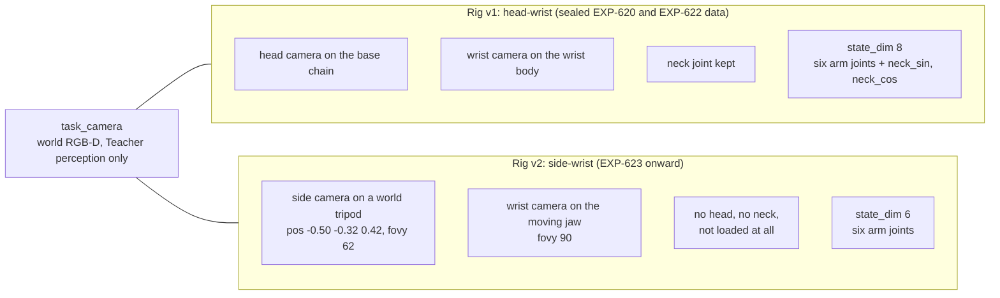

Figure 4. The two rigs. The task camera belongs to the Teacher and is in neither observation.

| | Rig v1 `head-wrist` | Rig v2 `side-wrist` |
| --- | --- | --- |
| Cameras in the observation | `head`, `wrist` | `side`, `wrist` |
| Topics | `/head_camera/color`, `/wrist_camera/color` | `/side_camera/color`, `/wrist_camera/color` |
| Head, neck | present | not in the model, plugin file or controllers; no topic, node, bag channel or log line |
| `state_dim` | 8 | 6 |
| Frame-file keys | `head_png`, `wrist_png` | `side_png`, `wrist_png` |
| Profile file sha256 | not recorded in the ledger | `145e0650...` (file), `0843746f...` (validated digest) |
| Data | EXP-620 (69), EXP-622 (33): sealed, 100 episodes merged | EXP-625: 103 episodes |
| Status | kept so the sealed data still exports and trains | current rig |

Facts the design adds. The rig profile is part of the frozen inputs and of the controlled identity, so data from the
two rigs can never mix. A real-data differential readback over the 101 merged v1 entries stayed byte-identical after
the change (101 equal, one episode, `frm-044`, refused identically; CP-3722, CP-3732). Cameras are 640x480 at 10 Hz;
the side camera publishes RGB only. The head, the head-search code and the teleop head UI stay in the tree for a future
mobile base (an AGV with a mast camera), but nothing composes them.

### 1.5 Stages and what each one produces

| Stage | Command or tool | Main output | Section |
| --- | --- | --- | --- |
| Scene lists | `act_sample`, evidence-side generators | `*.scenes.json` with splits | 3.1 |
| Gate | `scripts/gate/run_host_gate.zsh` | `R/gates/<id>/gates-result.txt`, install tree | 2.10 |
| Images | `scripts/images/build_images.zsh` | shard and inference image digests | 3.5 |
| Contact policy | `act_collect_contact_calibration`, `act_analyze_contact_calibration`, `act_contact_spot_check`, `act_activate_contact_policy` | activation receipt | 2.9 |
| Qualification | `act_collect_parallel --qualification`, `act_build_parallel_qualification_report`, `act_verify_parallel_qualification` | `host/qualification-report.json`, proof | 3.2 |
| Formal collection | `act_collect_parallel` | run root, `collection-index.json`, `campaign-result.json` | 3.2 |
| Seal | `scripts/evidence/seal_roots.py` | `SEALED.json`, seal manifest, `SEALED-ROOTS.json` | 5.3 |
| Export and training | `act_train` | dataset, bundle, `training-outputs.json` | 2.6 |
| Offline evaluation | `act_offline_evaluate` | `offline-eval.json` | 2.7 |
| Rollout | `act_rollout_native`, `act_evaluate` | per-episode evidence, `summary.json` | 2.8 |

---

## 2. Component design

### 2.1 The container campaign

`act_collect_parallel` is the single entry point for collection. The old native `act_collect` path is gone (commit
`83075e656`). A campaign has four planes, chosen by flags, that differ in worker count, scene count and what they may
produce.

| Plane | Flags | Workers | Scenes | Produces |
| --- | --- | --- | --- | --- |
| Functional (debug) | `--qualification`, functional contract | 1, 2 or 8 | 8 or 16 | Nothing exportable, never a qualification report |
| Qualification | `--qualification`, gate contract | 8 | 40 | `qualification-report.json` (Teacher at least 38 of 40, QC at least 34 of 40) |
| Formal | none, `--qualification-report` required | 8 | scene list (70, 33, 103) | `collection-index.json` with committed episodes |
| Spot check | `--spot-check` | 1 | exactly 1 | A verdict input only; the index lists no committed episode |

Sources: `cli/act_collect_parallel.py` docstring (code), template README (record). The pass counts are from the
template README. A native single-worker launcher (`--instance-launcher native`) exists for qualification-mode runs
with one worker; a formal run needs eight workers, so it is always containers.

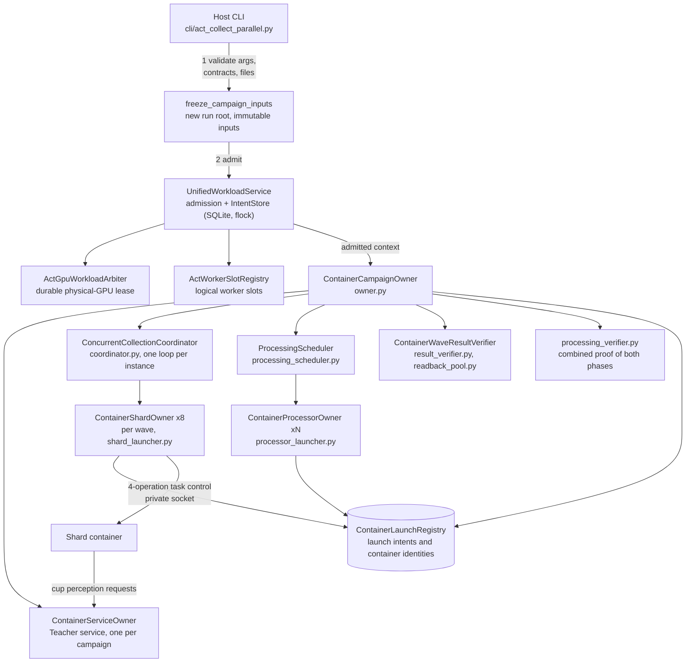

Figure 5. Components of the container campaign. Arrows show ownership or calls; none of the containers can start another.

Responsibilities (code, module docstrings):

| Component | File under `src/so101_demo_py/src/runtime/container_campaign/` | Job |
| --- | --- | --- |
| Host CLI | `cli/act_collect_parallel.py` | Refuses everything refusable before admission; exits 0 (settled), 2 (refused before admission), 1 (anything after) |
| Admission | `so101_teleop/unified/admission.py` | The only way a mutation reaches execution resources; takes the GPU lease and worker slots |
| Intent store | `unified/intent_store.py` | One private directory, one exclusive `flock`, every change in one `BEGIN IMMEDIATE` SQLite transaction with `synchronous=FULL` |
| GPU lease | `unified/gpu_workload.py` | Durable ownership of one physical GPU; workers receive a frozen environment and never read the lease |
| Owner | `owner.py` | Services survive waves; shards retire before a slot is reused; settles only after every original container stop is proven |
| Coordinator | `coordinator.py` | One Host loop per instance over four-operation task control; assigns one task at a time; a lost reply is queried, never resent; a fault ends that instance only |
| Recording gate | `coordinator.py` `RecordingGate` | Limits when the Host may assign: recording slots, tasks in flight, gap between assignments |
| Teacher service | `service_owner.py` | Campaign-lifetime inference container borrowed by cases and waves |
| Shard | `shard_launcher.py`, `shard_owner.py`, `runtime/act_instance/` | One container per worker slot per wave; runs the fixed-identity ACT stack and serves task control |
| Processor | `processor_launcher.py`, `processor_owner.py`, `runtime/act_processor/` | Phase-2 container: the shard image with a different entrypoint (`campaign_processor`) |
| Registry | `registry.py` | Durable launch intents; an unknown launch identity stays fenced |
| Verifiers | `result_verifier.py`, `readback_pool.py`, `processing_verifier.py` | Independent Host readback of every scene, one short-lived interpreter per scene |

Design rules worth remembering:

- Shards are isolated. Every shard runs the same fixed ROS identity (domain 181, no namespace), with
  `--network none --ipc private`, so no per-worker domain code exists in the ACT path. Host-assigned identities (worker
  id, launch generation, session id, task id) are never ROS names.
- Control is one-way and Host-initiated. The four operations are `start`, `assign_task`, `get_status` and
  `terminate` (design `2026-10-12-so101-container-one-way-control`, `2026-10-15` two-phase design).
- Waves. `plan_campaign_waves` splits the scene list into waves of at most 20 (`max_wave_size`), served by eight
  shards. Reserved scenes go first, then surplus scenes. EXP-625 used waves of 20, 20, 20, 20, 20 and 3.
- Cleanup. `finish` settles the lease and slots only after each original container stop is proven. If a stop cannot
  be proven, the CLI exits 1 with `CAMPAIGN_CLEANUP_UNCONFIRMED` and leaves the lease and slots held. A held lease may be released by hand only
  under a standing authorisation with fixed preconditions, and each release is logged (CP-3714, CP-3733).
- Disk guard. The owner checks free space every second. Below `disk_free_min_bytes` (53,687,091,200, 50 GiB, from
  `config/act/endpoint_pose_development_runtime.yaml`) it stops dispatch with `CAMPAIGN_DISK_FLOOR_REACHED`.

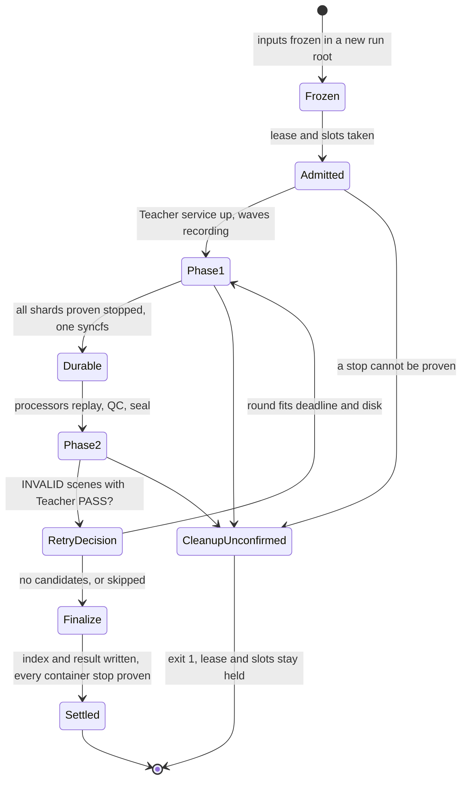

Figure 6. Lifecycle of a formal campaign, from `owner.py` (`_run`, `_finish_phase1`, `start_phase_two`, `_retry_rounds`).
Phase 1 reopens for each retry round.

Task control for one instance:

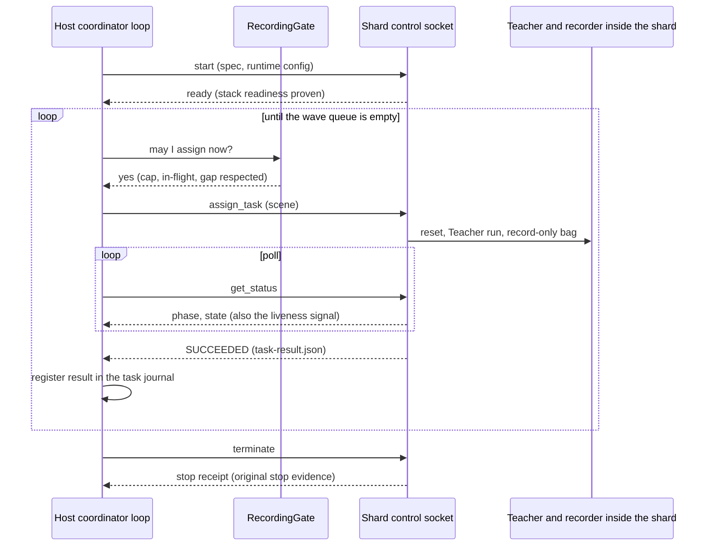

Figure 7. Four-operation task control (record: coordinator.py docstring, two-phase design).

### 2.2 Teacher, perception and the recorder

The Teacher is a scripted pick-and-place expert (MoveIt planning, ros2_control controllers). Its decisions are
independent of the data side: since CP-3262 ACT data validity does not depend on Teacher process quality, and the
Teacher execution policy (schema 3) lets the Teacher abort only on input unavailability, execution failure, operator
and watchdog stops, `TEACHER_JOINT_STATE_UNAVAILABLE` and `SIM_INTEGRITY_*`. Contact facts (force, compression,
collision) are recorded in `teacher_process_summary` and never stop or branch the Teacher.

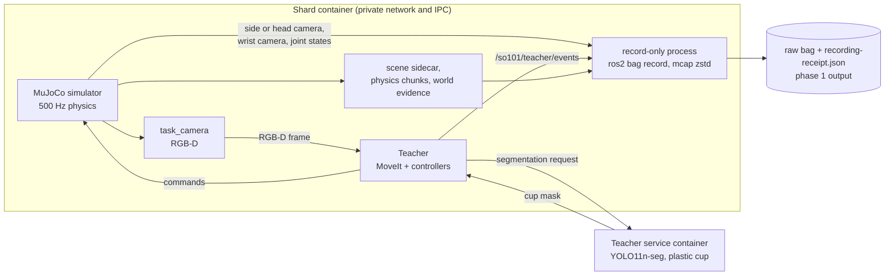

Figure 8. Data flow inside one shard during phase 1.

Facts:

- Cup perception uses the world `task_camera` RGB-D stream and a YOLO11n-seg model
  (`plastic-cup-yolo11n-seg-v1`, one class `plastic_cup`, score threshold 0.25, image 640x480). The Teacher service
  container runs it once per campaign (`instances: 1`, torch threads 1, up to 8 requests in flight, 10 s queue and 20 s
  inference timeouts; record: EXP-625 `campaign-config.json`). `task_camera`'s TF is hard-coded in
  `runtime/camera_tf.py`. The weights file `best.pt` has sha256 `f281d252...`; the path stays under
  `REG/models/huggingface/` because sealed configs name it.
- The Teacher's success rule is `teacher_endpoint` (`config/act/teacher_endpoint.yaml`): start position within
  0.010 m and axis within 0.15 rad; final xy within 0.020 m, z within 0.010 m, axis within 0.15 rad; settle 0.5 s.
  Missing observations give `UNCONFIRMED`, never `PASS`. Yaw about the cup axis is not restricted.
- The carry is slow on purpose: velocity scaling 0.03, acceleration scaling 0.0075, so the base-yaw ramp does not run
  the cup compression away. Place height is tilt-compensated with a closed fallback
  (`config/act/teacher_execution_policy.yaml`).
- The contact policy supplies the thresholds of the oracle flags (`ORACLE_CUP_OVERLOAD`, `ORACLE_COLLISION`, ...).
  An episode whose oracle is incomplete grades INVALID with `TEACHER_ORACLE_EXCLUDED` and becomes a retry candidate
  (O2, CP-3723). One rule is used by export and by phase-2 grading, so a committed episode is always exportable.
- Raw bags are recorded as mcap with zstd Fastest chunks of 4 MiB. One EXP-609 bag went from 2.04 GB to 0.29 GB
  (7.11 times) with all 284,657 messages identical (CP-3693).
- A Fast DDS profile (`config/dds/fastdds-collection.xml`, heartbeat 20 ms, NACK response delay 1 ms) is applied to
  every collection ROS process. It removed the class A late-delivery events in a reproduction with eight mini-shards
  (0 messages later than 50 ms in two runs; CP-3703, CP-3707).
- The shard status carries a `phase` field; `max_concurrent_recordings` (default 4) bounds how many shards record at
  once. At cap 8, loss per shard-second was 3.6 against 0.016 to 0.038 with one to four recordings (EXP-589).

### 2.3 Phase 2: offline processing

Phase 1 only records. Everything that decides data validity runs afterwards in processor containers, on a virtual
clock fed from the bag (design `2026-10-15-so101-act-two-phase-collection-design.md`, CONFIRMED). The processor drives
the same recorder engine and sources as the old live recorder, replacing only the receipt instant of each message with
the record-only process's receipt. The verdict therefore does not depend on when or where it runs.

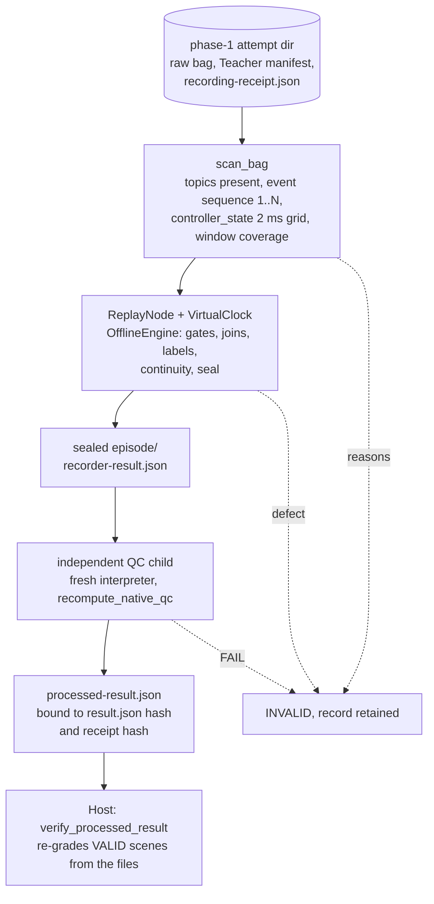

Figure 9. One processing task (code: `act/offline/processor.py`, `scan.py`, `engine.py`, `replay.py`, `independent_qc.py`,
`act/processed_result.py`).

The processor exit codes are 0 (VALID and QC PASS), 3 (INVALID data, final), 2 (refused configuration) and 4
(infrastructure failure). The scheduler uses them:

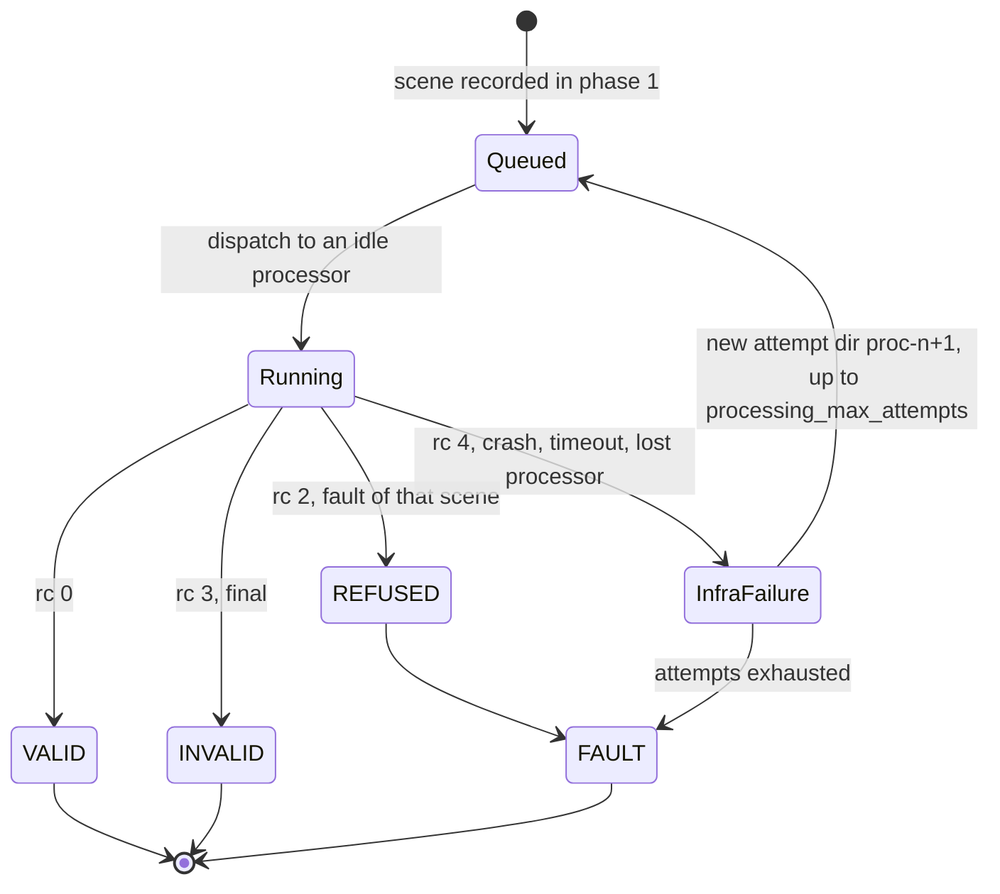

Figure 10. Task outcomes in `processing_scheduler.py`. Every event is appended and fsynced to
`host/processing-journal.jsonl` (sequence numbers must run 1, 2, 3 without a gap).

After phase 2 the Host builds a combined per-scene record. Each scene ends in exactly one of four states
(`processing_verifier.py`):

| State | Meaning |
| --- | --- |
| `PROCESSED` | A final processing attempt whose result read back; the data verdict is VALID or INVALID |
| `FINAL_AT_PHASE1` | The phase-1 record is already final (a pre-motion Teacher failure that recorded nothing) |
| `FAULT` | Processing was refused, retries ran out, records disagree, or the phase-1 task faulted |
| `MISSING` | No evidence: never recorded, phase 2 ran out of time, or never processed |

`FAULT` and `MISSING` are never a pass. Phase-2 time limits (`processing_limits.py`):

- `batch_hard_timeout_s`, the total: from the campaign config when present, else the runtime YAML (9000 s).
- Phase 1 ends at `collect_timeout_s` if set, else at the total minus the phase-2 reserve
  (`process_timeout_s`, else `processing_reserve_s`, 1800 s by default).
- Phase 2 ends at `process_timeout_s` from its start, or the total minus `verification_reserve_s` (600 s), whichever is
  earlier. The Host's own readback runs after phase 2 and needs that reserve.
- Default processor count is `min(12, MemAvailable / 3 GiB)`, at least 1. A processor peaks near 2.2 GiB, and the
  QC child runs after it.
- Phase 2 mounts every phase-1 sealed attempt read-only into each processor and gives one writable
  `<run>/processing` tree.

### 2.4 Retry rounds

A scene is a retry candidate when its latest attempt is PROCESSED, its Teacher passed, and its data verdict is
INVALID. Candidates are recorded again in a new round on the same eight slots (design
`2026-10-16-so101-act-delivery-fix-and-retry-design.md`, CONFIRMED; the formal plane only).

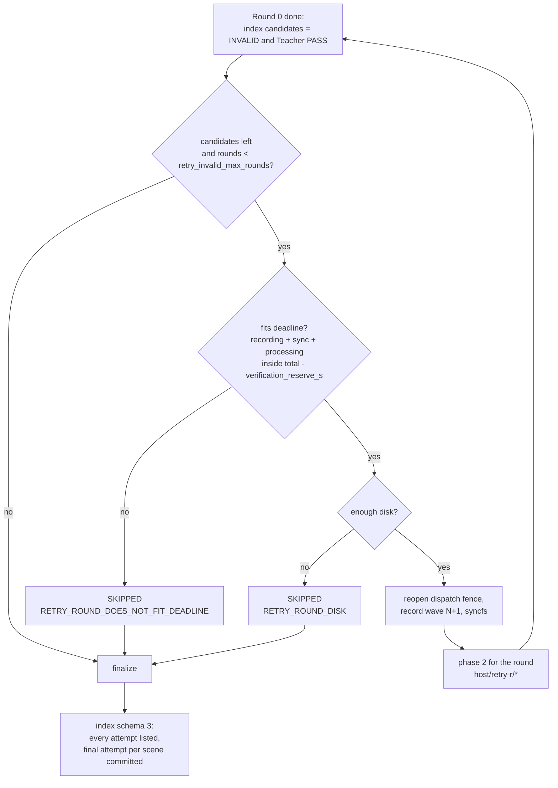

Figure 11. The retry loop (`owner.py` `_retry_rounds`, `processing_limits.retry_round_plan`).

Never retried: Teacher FAIL, FINAL_AT_PHASE1, FAULT and MISSING scenes. Qualification runs refuse retry, so they keep
measuring first-attempt quality. In EXP-625, round 0 had 98 VALID and 5 INVALID; round 1 recovered four and round 2
recovered the fifth.

### 2.5 Collection index, sealing and export

`host/campaign-result.json` and `collection-index.json` come from the combined per-scene proof. With retry rounds the
index is schema 3: `collected_tasks` lists every recording attempt (with `recording_round`, `wave_index`, `final`) and
`committed_episodes` holds only the final attempt of each scene, so export needs no change.

Export (`act/bundle.py`):

- `resolve_committed_episodes` accepts only episodes the coordinator committed, with a verifier receipt that agrees
  with the journal. An episode directory is not an episode until then.
- `export_dataset` writes one JSON document per committed episode plus the frames and an `export-manifest.json`
  holding the sha256 of the source manifest and the campaign index. It is parallel (`SO101_ACT_EXPORT_WORKERS`, 16 in
  practice). The dataset stays self-contained and copies frames, because evidence directories get cleaned up
  (human decision, 2026-10-19).
- Normalisation statistics may only come from the train split (`training_rows`).
- The verified-collection check runs once per file set per process (a process-local memo bound to file and tree
  signatures; CP-3720). Under the approved F4/P3 decision, intermediate passes trust the content-bound QC memo and
  only the final pass recomputes QC in full (planned, to-do items 2a to 2f).

The export format is the repository's own (`episodes/<id>.json`, a per-episode `frames` directory,
`export-manifest.json`), not a LeRobot dataset on disk. LeRobot 0.6.1 is used as the model library; the
adapter converts samples to its batch layout in memory. Not verified: whether any tool converts the export to the
LeRobot on-disk dataset format (none was found).

### 2.6 Training

`act_train` runs on ai-station inside the `so101-act-train` virtual environment. The launcher script
`W/so101-tools/training/run_train_reuse.zsh` sets `TMPDIR` under the evidence run directory, checks that
`tempfile.gettempdir()` resolves there, sources ROS Jazzy and a gate install, and calls the module.

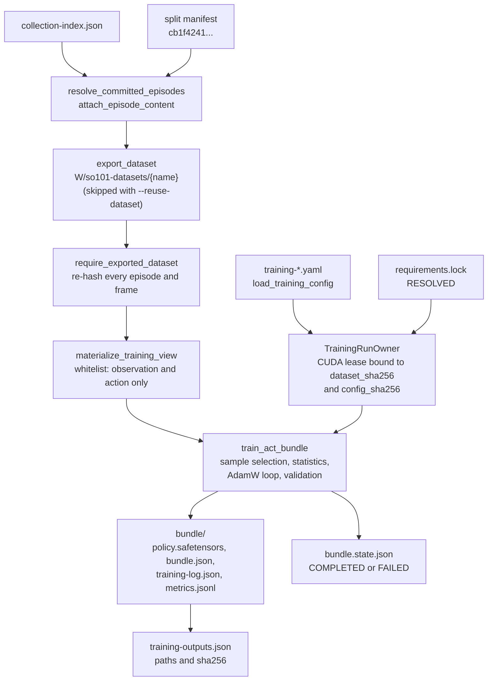

Figure 12. From index to bundle (code: `cli/act_train.py`, `act/training.py`, `adapters/act/lerobot.py`).

Key behaviours (code):

- Training starts only against a verified export, a resolved `requirements.lock` (status `RESOLVED`, 2026-09-28
  resolver run), a valid frozen config, a CUDA device and a free output path. `--device` must be `cuda`; there is no
  CPU path. The run always leaves a terminal state file.
- `--reuse-dataset` skips the export but requires the existing export's manifest to name the sha256 of `--manifest`
  and `--campaign-index` (`TRAINING_REUSED_DATASET_MISMATCH` or `_MISSING` otherwise). The training gate still re-hashes
  every episode and frame.
- `chunk_size` is frozen at 10 and `execution_prefix` at 1 by `training_config.py` (`_SMOKE_CHUNK_SIZE`,
  `_SMOKE_EXECUTION_PREFIX`). Other values are refused; execution is changed at rollout time instead (section 2.8).
- The model is LeRobot's `ACTPolicy` with `NormalizationMode.IDENTITY` inside the policy. The adapter normalises state
  and action with train-split mean and std (std floor 0.01) stored in the bundle, and `LerobotPolicy.infer` undoes it.
- The training lease is taken by `TrainingRunOwner` through `ProcessTableArbiter`, which reports IDLE only when no
  process holds a CUDA compute context (`nvidia-smi --query-compute-apps`). Training therefore cannot start while
  another process, such as a collection campaign or a rollout, uses the GPU.
- The pretrained ResNet18 backbone (ImageNet1K_V1, sha256 `f37072fd...`) is loaded from a local, hash-verified file and
  never downloaded.
- Optimiser: AdamW, weight decay 1e-4 (`_WEIGHT_DECAY`), gradient clip norm 10.0 (`_GRAD_CLIP_NORM`), backbone learning
  rate `learning_rate_backbone` (1e-5) separate from `learning_rate` (1e-4). Both constants are hard-coded and in no
  hash today (planned: design 2026-10-19).
- Progress: `metrics.jsonl` and one stdout line every 100 steps (window losses, learning rate, samples/s, ETA,
  DataLoader wait versus compute); validation L1 on a fixed set of 512 chunks every 2000 steps with no effect on the
  training RNG.

**Model.** The trained model has 51,576,454 parameters in 234 tensors (counted from the TRAIN-003 `policy.safetensors`
header on 2026-10-20). The module breakdown below follows the safetensors key prefixes; the layer shapes are those of
LeRobot's default `ACTConfig` (4 encoder layers, 1 decoder layer, 4 VAE encoder layers, feed-forward width 3200; the
counts reproduce exactly).

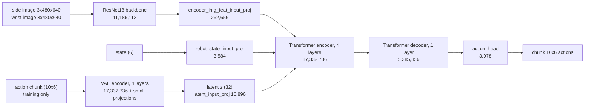

Figure 13. ACT model modules and parameter counts.

| Module (key prefix) | Parameters | Share |
| --- | ---: | ---: |
| `model.encoder` (4 layers) | 17,332,736 | 33.6 % |
| `model.vae_encoder` (4 layers) | 17,332,736 | 33.6 % |
| `model.backbone` (ResNet18) | 11,186,112 | 21.7 % |
| `model.decoder` (1 layer) | 5,385,856 | 10.4 % |
| input and output projections, position embeddings, `action_head`, CLS embedding | 339,014 | 0.7 % |
| Total | 51,576,454 | 100 % |

(The last row is the remainder of 51,576,454 after the four large modules; the file is 206,331,088 bytes in fp32.)

**Training view and sample selection.** The training view turns episodes into samples: a start row plus the next
`chunk_size` action targets, padded at the end of an episode with a mask (`tail_padding_mask`). Three optional
selections exist, all in `training.sample_selection` (`adapters/act/lerobot.py`). They change which rows start a chunk
or which rows exist; they do not change the maths. They are applied to the validation split by the same rule.

| Mode | Rule (raw radians, six arm joints) | Used in |
| --- | --- | --- |
| `trim_leading_idle` | Drop chunk start rows before `max(0, r* - lead_in_rows)`, where `r*` is the first row with `max_j abs(a - s)` above `idle_threshold_rad` (0.005) | TRAIN-002, TRAIN-003 (73,437 to 70,003 train samples) |
| `trim_interior_idle` | Also drop every start row whose whole next chunk is static (max over next `chunk_size` actions of `abs(a[t+k] - s[t])` strictly below the threshold), except the last `keep_tail_rows` (20) | TRAIN-004 (73,437 to 66,896) |
| `compress_dwell` | Remove dwell rows from the episode timeline itself, as observations and as action targets; a row before the tail is a dwell row when `max_j abs(a[t] - s[t])` and `max_j abs(s[t+1] - s[t])` are both strictly below the threshold; keep the last `keep_tail_rows` rows | TRAIN-005 (73,437 to 26,461; validation 8,701 to 3,048) |

`compress_dwell` is refused together with `trim_interior_idle` or `trim_leading_idle: true`
(`TRAINING_SAMPLE_SELECTION_INVALID`). The normalisation statistics stay those of the exported episodes.

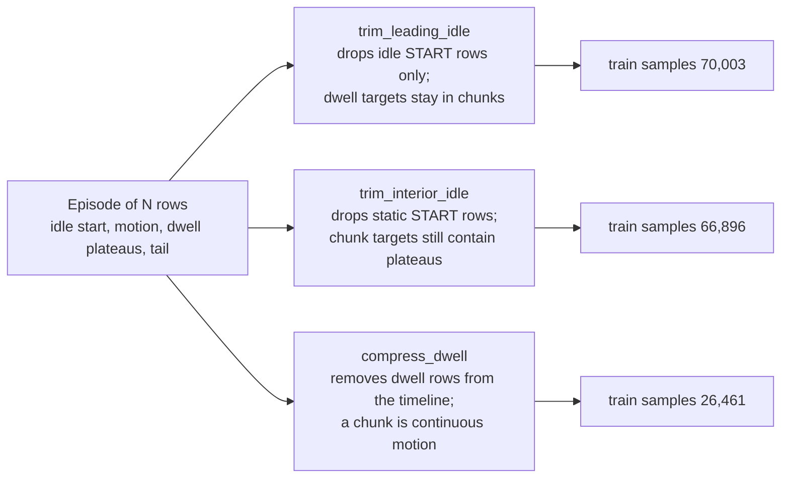

Figure 14. Three sample-selection modes and the TRAIN-003/004/005 row counts (record: CP-3742, CP-3745, CP-3748).

**Speed options** (all opt-in; an absent key keeps the old behaviour and the old config hash):

- `_prefetched`: a background thread with a queue two batches deep between the DataLoader and the step. Always on.
  Batch order and content are unchanged.
- `training.cudnn_benchmark` and `training.channels_last` (backbone only). Not bit-identical to eager.
- `training.compile`: `policy.model.compile()` in place, so `state_dict` keys stay unchanged (234 keys, no
  `_orig_mod.`; checked on antzb).
- `training.precision: bf16`: autocast around the training forward and loss only. Validation, weights, gradients and
  the AdamW state stay fp32; no GradScaler.

### 2.7 Offline evaluation

`act_offline_evaluate` runs in the training interpreter, never in the ROS environment, and drives no controller. It
takes `--manifest`, `--bundle`, `--freeze` and `--output`, verifies a freeze of six digests (bundle, dataset manifest,
campaign index, split manifest, calibration, runtime config) and scores the Offline Test split. Padded tail frames are
masked out of every joint metric, and the model is reset per episode (code: `act/offline_evaluation.py`; the
ten-episode minimum and the cross-split refusal come from the earlier guide and were not re-read).

What the metric can and cannot say (record: EVAL-001, EVAL-003, antzb section 12.3): the first action of a chunk is
almost the current state, so "repeat the current state" scores 0.0019 rad and beats the policy (0.0063 rad for the
TRAIN-003 policy; 0.0143 for TRAIN-001). The policy is far better than a constant (0.206 rad), and over whole chunks it
beats repeat-state (0.0063 against 0.0101). Offline error does not predict closed-loop success: TRAIN-004 had validation
L1 0.0198 and finished 0 of 16 rollout episodes. Use closed-loop rollout as the judge.

### 2.8 Native rollout executor

`act_rollout_native` runs a bundle in closed loop on the host (outside containers, one episode at a time), on the same
MuJoCo stack and launch path as collection (design `2026-10-18-so101-act-native-rollout-design.md`, CONFIRMED).

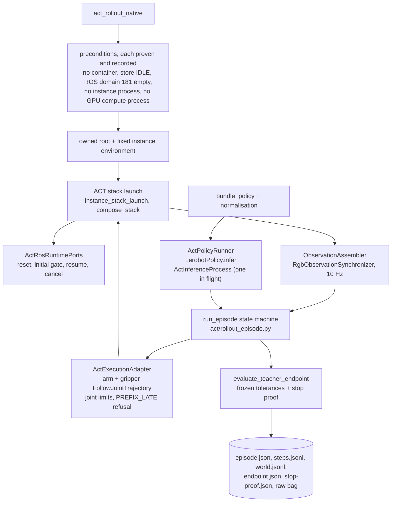

Figure 15. Rollout components. Unified admission is bypassed for this tool (decision D5), so it proves its own
preconditions first.

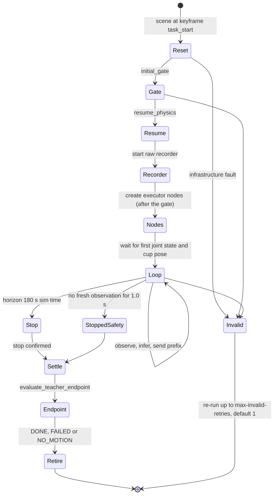

Figure 16. One rollout episode (`act/rollout_episode.py`). Verdicts: `DONE` (endpoint PASS with confirmed stop),
`FAILED`, `NO_MOTION` (the arm never moved), `INVALID` (infrastructure; re-run and reported apart).

**Execution modes** (added 2026-10-19, CP-3744; `act/rollout_execution.py`; a LOGIC setting recorded in `run.json`,
every `episode.json` and, for an override, in `identity.execution_mode`):

| Mode | Flag | Behaviour |
| --- | --- | --- |
| Bundle default | none | Infer at every observation and send only `chunk[0]` (`execution_prefix` 1) |
| Prefix N | `--execution-prefix N` (1..`chunk_size`) | Send the first N actions as one trajectory (targets observation + 0.1 s x 1..N), infer again from the first observation at or after the last target (10 ms tolerance); observations in between are logged `PREFIX_IN_PROGRESS` |
| Temporal ensembling | `--temporal-ensembling [M]` (bare flag M = 0.01) | Infer at every observation; the action for T = observation + 0.1 s is the mean of every earlier chunk still covering T, weights `exp(-M*i)`, i = 0 for the oldest chunk |

The two flags are exclusive. A late reply, or a prefix that is late at submission, sends nothing (the previous goal
holds), starts no wait, and the next observation infers at once. A late prefix is held whole, never trimmed.

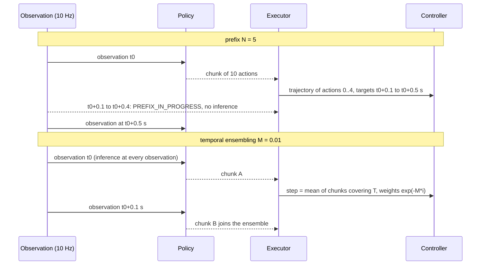

Figure 17. The two execution overrides.

Scene groups (design D7; `act/rollout_scenes.py`): `rollout_standard` is the four points of
`config/mujoco/rgbd_task_points.yaml` (`task_start`, `forward_5cm`, `left_5cm`, `right_5cm`; the last is about 51 mm
outside the training data), `rollout_validation` and `rollout_test` are sampled inside the anchor triangle from new
seeds (576010, 576011), and `rollout_extrapolation` is optional. `rollout_test` is opened once per policy. Success is
judged by `evaluate_teacher_endpoint` with two recorded substitutions: the start target is the scene's commanded reset
pose, and COMPLETED means the horizon was reached or the policy stopped and settled with a confirmed stop.
`act_evaluate` reports each route and group; `--contact-activation-receipt` replaces the never-produced QUALIFIED
calibration report and is recorded as a substitution (D8).

### 2.9 Contact-policy calibration, spot check and activation

The contact policy turns recorded contact physics into thresholds for the Teacher's oracle flags. It is bound to the
compiled model and scene, so a new robot model (rig v2) needs a new policy. A policy is only usable after an activation
receipt exists and was verified.

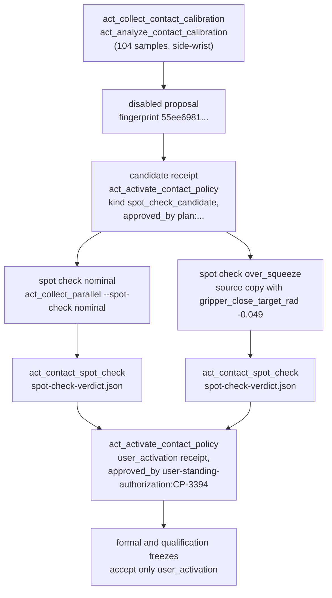

Figure 18. From calibration to activation (design `2026-10-18-so101-act-container-spot-check-design.md`, CONFIRMED).

- Nominal PASS: Teacher COMPLETED, endpoint PASS, no oracle flag, complete summary, phase-2 QC PASS, frozen close
  target not the over-squeeze value.
- Over-squeeze PASS: close target -0.049, Teacher COMPLETED, `ORACLE_CUP_OVERLOAD` between `CLOSE_GRIPPER` and
  `VERIFY_PHYSICAL_GRASP`, peak force or compression above the frozen limits, thresholds equal the proposal's, no
  `ORACLE_COLLISION` first. An over-squeeze episode usually ends INVALID in phase 2 with `PHYSICS_RAW_SOURCE_HAZARD`
  and no QC report, and that outcome is accepted (CP-3735, CP-3736).
- The spot-check plane never yields committed episodes. Defences: the index has `qualification: true`, `bundle`
  refuses a qualification index, formal admission accepts only a gate-contract report, and
  `collection_qualification_recompute` requires a formal frozen mode with `user_activation`.
- Record: side-wrist policy `55ee6981` was activated after EXP-7002 (nominal) and EXP-7003 (over-squeeze) both passed
  (CP-3737).

### 2.10 Gates and input templates

**Host gate** (`scripts/gate/run_host_gate.zsh`). Run it from the worktree under test, with a clean worktree. It builds
the colcon workspace, runs the `so101_demo_py` pytest suite in parallel workers, and runs the colcon tests, with skip rules for
the ros2_control and joint_trajectory_controller suites when the tree and apt hashes equal a green baseline.

The gate tools are tracked in git, so every host runs one versioned copy. A gate result is valid only if `scripts/gate` is
clean at the tested commit; each result directory records the tools commit (`gate-tools.txt`). Host-specific values (evidence
root, build root, interpreters, demo workers, staged mode, memory scope) live in `scripts/gate/hosts/<host>.env`, and the
entry point takes `--host <name>` or detects the host from `hostname`. The evidence tools (`scripts/evidence/`), the image
build (`scripts/images/`) and the samplers (`scripts/run_tools/`) read the same host values. After a failed gate, one rerun of
failures listed in `scripts/gate/known-flakes.txt` runs by default. See `scripts/gate/README.md`.

| Item | Where |
| --- | --- |
| Build, install, log, test-run trees | `BUILD_ROOT/gates/<id>/` (`W/so101-build/gates/<id>/` on ai-station) |
| Results: `gates-result.txt`, `fast-gate-timing.txt`, `head.txt`, `*.rc`, decisions | `R/gates/<id>/` |
| Pointer to the build root | `R/gates/<id>/build-root.txt` |
| Per-run `TMPDIR` for pytest and colcon test | `R/scratch/gate-<id>/` (about 12 GiB each; deletion candidate after readback) |
| ccache | `W/so101-build/ccache` |

A green gate records `build_rc=0 demo_rc=0 colcon_rc=0`, `head_after` and `dirty_after=0`. Typical times: build 45 s,
demo about 450 s, colcon about 135 s (CP-3731, CP-3732).

**Input templates** (`REG/act-templates/`, tooling outside git). Each template holds scripts and fixed scene lists, no
authored output. `new-inputs.py` clones one into a fresh inputs directory, and `author.py` writes `params.json`,
`params.zsh`, the contract, `campaign-config.json` and its provenance, runs image readbacks, `inspect.zsh` and
`validate-inputs.zsh`, and finishes with `sha256sums.txt`.

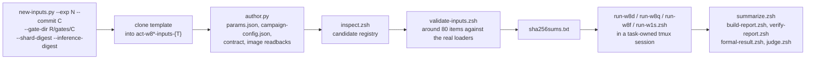

Figure 19. Template author, validate and run flow.

| Template | Plane | Scenes |
| --- | --- | --- |
| `w8d-debug` | functional | 16 |
| `w8q-qualification` | gate | 40 |
| `w8f-formal` | formal | 70 |
| `w8q-qualification-sup`, `w8f-formal-sup` | gate, formal | a `--formal-list` of N scenes |
| `w8d-debug-side-wrist`, `w8q-qualification-side-wrist`, `w8f-formal-side-wrist` | rig v2 | 16, 40, any list |
| `w1s-spotcheck-side-wrist` | spot check | 1 |

Frozen inputs: the scene list, rule files, contracts and the rig profile. Templates also froze runtime scripts and
source-text patterns today, which broke twice (EXP-624 verify, EXP-625 authoring). The planned fix (section 4.1) freezes
only logic files and replaces text patterns with behavioural tests.

### 2.11 Admission and the startup proof

Every mutation that needs execution resources goes through `AdmissionGateway`. A mutation is classified; read-only
operations take no reservation, and an unknown operation is refused. Collection start binds the **controlled
identity** (`_collection_identity`): `source_sha256`, `runtime_config_sha256`, `collection_config_sha256`,
`contact_policy_fingerprint`, `gpu_uuid`, the inference and shard image records, and (when the campaign names a rig)
`rig_profile_sha256`.

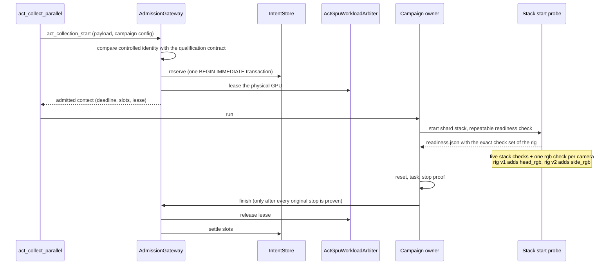

Figure 20. Admission and the stack startup proof (code: `admission.py`, `pick_place_startup_issuer.py`,
`pick_place_startup_proof.py`).

The exact readiness check set comes from the rig: `checks_for_rig(rig, rig_profile)` gives the five stack checks
(`mujoco_session`, `advancing_physics`, `controller_states`, `moveit_graph`, `physical_stop`) plus one `<camera>_rgb`
per camera. Equality is exact: no subset, no superset. Two live defects (CP-3730, CP-3732) came from a validator that
still expected `head_rgb`; the fix removed every default so nothing can silently mean rig v1.

---

## 3. Workflows

### 3.1 From scene list to rollout

The ladder has one rule: each rung is a separate run with its own run id, and nothing skips a rung. A new camera rig or
a new contact policy restarts the ladder from the gate.

```mermaid
flowchart TB
    SC["Scene generation<br/>sampler inside the anchor triangle,<br/>0.004 m apart, place exclusion,<br/>five-pose Teacher reachability"] --> LISTS["lists: debug-16, qualification-40,<br/>formal N with splits"]
    GATE["Host gate green"] --> IMG["build shard and inference images<br/>at the gated commit"]
    IMG --> TPL
    LISTS --> TPL["templates: new-inputs.py + author.py<br/>validate-inputs"]
    CP["contact policy activated<br/>for this model and scene"] --> TPL
    TPL --> DBG["Debug run, 16 scenes<br/>w8d: look at frames and delivery"]
    DBG --> QUAL["Qualification, 40 scenes<br/>w8q: Teacher at least 38, QC at least 34"]
    QUAL --> REP["build-report, verify-report<br/>QUALIFIED report + proof"]
    REP --> FORMAL["Formal collection<br/>w8f: retry_invalid_max_rounds 2"]
    FORMAL --> POST["formal-result.zsh<br/>clean finish, index shape,<br/>committed = export eligible"]
    POST --> SEAL["seal_roots.py<br/>SEALED.json + registry"]
    SEAL --> TRAIN["act_train (export + training)"]
    TRAIN --> EVAL["act_offline_evaluate"]
    TRAIN --> ROLL["act_rollout_native<br/>4 standard points"]
```

Figure 21. The experiment ladder.

Scene generation. A scene is a cup position and a seed. Candidate points come from a sampler over the triangle of three
approved anchors (`config/act/pick-place-live-anchors.yaml`: default, left, forward), kept at least 0.004 m apart,
outside a 0.060 m exclusion around the place target, and accepted only if a physical reachability check passes for the
Teacher's five poses (the rule set `act/rollout_scenes.py` reuses; for formal lists record: rig v2 design "0.004 m scene
generation rules"). The formal list of EXP-625 is `formal-103.scenes.json` (waves 20, 20, 20, 20, 20, 3; splits train
83, validation 10, offline_test 10; sha256 `8198e4b1...`). Qualification-40 and functional-8 stay disjoint from any
formal list by id and by position. The same position set may be reused across rigs because data from the two rigs
never mix.

### 3.2 Formal collection, end to end

```mermaid
sequenceDiagram
    participant OP as Operator (tmux run-w8f.zsh)
    participant CLI as act_collect_parallel
    participant ADM as Admission and GPU lease
    participant OWN as Campaign owner
    participant TS as Teacher service
    participant SH as Shards (8 per wave)
    participant PR as Processors
    participant VER as Host verifiers
    OP->>CLI: formal plane, qualification report, campaign config
    CLI->>CLI: refuse bad arguments, recompute qualification identity,<br/>freeze inputs in a new run root
    CLI->>ADM: admit
    ADM-->>CLI: lease and slots
    CLI->>OWN: run
    OWN->>TS: start once
    loop wave 0..k (up to 20 scenes each)
        OWN->>SH: launch 8 shards, assign scenes one by one
        SH-->>OWN: task results (Teacher verdict, raw bag, receipt)
        OWN->>VER: verify wave records from files
    end
    OWN->>OWN: prove every shard stopped, one syncfs
    OWN->>PR: phase 2: launch N processors, queue of recorded scenes
    PR-->>OWN: processed-result.json per scene (VALID or INVALID)
    OWN->>VER: verify_processing: combined proof of both phases
    loop retry rounds (0..3)
        OWN->>SH: re-record INVALID scenes with Teacher PASS
        OWN->>PR: process the round
    end
    OWN->>VER: final readback of every committed episode
    VER-->>OWN: campaign-result.json, collection-index.json
    OWN->>ADM: finish after every stop is proven
    CLI-->>OP: exit 0, one JSON line (campaign_id, run, plane, scene_count, waves)
    OP->>OP: formal-result.zsh, summarize.zsh, save container logs, remove containers
```

Figure 22. A formal collection (EXP-625 ran this sequence with 8 waves in total: 6 round-0 and 2 retry waves).

Operator actions around the run (record: CP-3741, CP-3739):

1. Preconditions: no container, no GPU compute process, no ROS/ACT/pytest process, store IDLE, enough disk
   (projection checked by `validate-inputs.py`).
2. Run inside a task-owned tmux session; the durable log directory is `R/run-logs/exp<N>`.
3. After the run: `formal-result.zsh` (10 items for EXP-625, including `bundle._verified_collection_uncached` for every
   committed episode and the Teacher-oracle rule), `summarize.zsh`, save container logs, remove the exited containers.
4. The coordinator seals the run and its inputs before anyone trains.

Time and footprint of EXP-625 (record): 168 min (23:57:14Z to 02:45:20Z), 10,086 s of a 14,400 s total, six
processors; 77 containers (64 shard, 12 processor, 1 Teacher); run root 65 to 66 GB (about 0.64 GB per scene).

### 3.3 Verify, seal, export, train, evaluate, roll out

```mermaid
sequenceDiagram
    participant CO as Coordinator
    participant SEAL as seal_roots.py
    participant TR as run_train_reuse.zsh and act_train
    participant GPU as GPU (CUDA lease)
    participant EV as act_offline_evaluate
    participant RO as act_rollout_native
    participant AE as act_evaluate
    CO->>SEAL: seal run root, inputs, scenes, gate
    SEAL-->>CO: per-file sha256 manifest, SEALED.json, read-only files, SEALED-ROOTS.json
    CO->>CO: merge indexes if needed (merge_indexes.py), write split manifest
    CO->>TR: --stamp S --dataset-name N --manifest --campaign-index --config
    TR->>TR: check tempfile.gettempdir() is under the evidence run dir
    TR->>TR: resolve committed episodes (16 workers), export or reuse, re-hash
    TR->>GPU: acquire lease (no other CUDA process allowed)
    TR->>GPU: train 60000 steps, validation every 2000
    TR-->>CO: bundle, bundle.state.json COMPLETED, training-outputs.json
    CO->>EV: freeze (six digests) and bundle
    EV-->>CO: offline-eval.json
    CO->>RO: bundle, scenes, gate install, execution override
    RO->>RO: preconditions, stack, episodes, stop proof
    RO-->>CO: per-episode evidence and videos
    CO->>AE: summarise per route and per group
    AE-->>CO: report with the substitution record
```

Figure 23. From sealed data to a rollout verdict.

TRAIN launcher facts (record: `run_train_reuse.zsh`): the script writes the evidence run directory
`<evidence-parent>/train-run-<S>/` (`training-outputs.json`, `export-manifest.json`, `owner/`, `console.log`, `tmp/`),
the dataset under `W/so101-datasets/<N>/` and the bundle under `W/so101-policies/train-run-<S>/bundle`. It sets
`TMPDIR`, `TMP` and `TEMP` to the evidence `tmp/`, checks it with `tempfile.gettempdir()`, imports either the live
worktree through the shim or a `git archive` snapshot of `--source-commit`, and logs `head`, `dirty_src` and the gate id
in `run-context.txt`.

### 3.4 The contact-policy spot-check and activation workflow

```mermaid
sequenceDiagram
    participant CO as Coordinator
    participant TPL as w1s-spotcheck-side-wrist
    participant CLI as act_collect_parallel --spot-check
    participant JD as act_contact_spot_check
    participant AC as act_activate_contact_policy
    CO->>CO: offline calibration, disabled proposal (fingerprint)
    CO->>AC: candidate receipt (spot_check_candidate, plan: approver)
    CO->>TPL: new-inputs.py --spot-check nominal
    TPL->>CLI: 1 worker, 1 scene (dbg-00), diagnostic mode
    CLI-->>CO: run root act-w1s-..., index with no committed episode
    CO->>JD: judge nominal run
    JD-->>CO: spot-check-verdict.json PASS or FAIL
    CO->>CO: source copy with gripper_close_target_rad -0.049
    CO->>TPL: new-inputs.py --spot-check over_squeeze --source-root copy
    TPL->>CLI: second run
    CO->>JD: judge over-squeeze run
    JD-->>CO: spot-check-verdict.json
    CO->>AC: user_activation receipt, both verdicts cited in approval_reference
    AC-->>CO: receipt sha256 (used by qualification and formal freezes)
```

Figure 24. Spot-check workflow. For the side-wrist policy `55ee6981` the runs were EXP-7001 (found the readiness
defect, CP-3730), EXP-7002 (nominal, PASS, CP-3735 after the judge fix of CP-3734) and EXP-7003 (over-squeeze, PASS, CP-3737).

### 3.5 The gate and image-build workflow

```mermaid
sequenceDiagram
    participant DEV as Writer (src change committed)
    participant GATE as run_host_gate.zsh
    participant BLD as W/so101-build/gates/ID
    participant EVD as R/gates/ID
    participant IMG as build_images.zsh
    participant TPL as templates
    DEV->>GATE: --demo-workers 12, clean worktree
    GATE->>BLD: colcon build (ccache), demo pytest, colcon test
    GATE->>EVD: gates-result.txt, build-root.txt, decisions
    GATE-->>DEV: build_rc, demo_rc, colcon_rc, head_after, dirty_after
    DEV->>IMG: prepare-image-build.py + build_images.zsh at the gated commit
    IMG-->>DEV: shard digest, inference digest, R/image-build-T
    DEV->>TPL: new-inputs.py --commit --gate-dir --shard-digest --inference-digest
    TPL->>BLD: read install through build-root.txt
    Note over TPL: git diff gated-commit HEAD -- src scripts third_party must be empty before a run
```

Figure 25. Gate to image to template.

Rules that go with it (record):

- A run uses the images and gate of one commit. Changing anything under `src/`, `scripts/` or `third_party/` after the
  gate invalidates the run's provenance; the Host CLI imports the worktree source at run time, so no writer may edit
  `src/` while a collection is active.
- Image builds: shard 155.6 s and inference 59.8 s on the first measurement, 396.5 s and 66.3 s with the vendored
  controllers.
- A full partition breaks the gate: each gate keeps about 12 GiB of scratch under `R/scratch/gate-<id>`, and collection
  integration tests fail with `CAMPAIGN_DISK_FLOOR_REACHED` when free space is below 50 GiB (CP-3745, CP-3747).

### 3.6 What has actually been run

```mermaid
gantt
    title Real runs (UTC unless noted)
    dateFormat YYYY-MM-DD HH:mm
    axisFormat %m-%d %H:%M
    section Rig v1 head-wrist
    EXP-620 formal 69 of 70          :done, a1, 2026-10-17 02:25, 2026-10-17 04:31
    EXP-622 supplement 33 of 33      :done, a2, 2026-10-17 08:48, 2026-10-17 09:53
    TRAIN-001 20000 steps            :done, a3, 2026-10-17 15:15, 2026-10-17 16:35
    TRAIN-002 stopped at step 2100   :crit, a4, 2026-10-18 09:00, 2026-10-18 09:20
    section Rig v2 side-wrist
    EXP-623 debug 15 of 16 VALID     :done, b1, 2026-10-18 18:09, 2026-10-18 18:30
    EXP-624 qualification 38 of 40   :done, b2, 2026-10-18 18:45, 2026-10-18 19:38
    EXP-625 formal 103 of 103        :done, b3, 2026-10-18 23:57, 2026-10-19 02:45
    TRAIN-003 60000 steps            :done, b4, 2026-10-19 03:42, 2026-10-19 10:42
    TRAIN-004 60000 steps            :done, b5, 2026-10-19 16:50, 2026-10-19 21:50
    TRAIN-005-bf16 (running)         :active, b6, 2026-10-20 00:10, 2026-10-20 04:00
    section Rollouts
    TRAIN-003 live fixes CP-3743     :b7, 2026-10-19 12:15, 2026-10-19 14:00
    TRAIN-003 exec modes CP-3744     :b8, 2026-10-19 14:07, 2026-10-19 16:30
    TRAIN-004 rollouts CP-3746       :b9, 2026-10-19 22:06, 2026-10-20 00:00
```

Figure 26. Timeline of the main runs. Start times are the run stamps in the ledger. End times are the recorded ones
where the ledger gives them (EXP-620, EXP-622, EXP-623, EXP-624, EXP-625, TRAIN-003 at 18:42 +0800 = 10:42Z); the
others are estimates drawn from step counts and wall-clock figures (TRAIN-001 elapsed 4785 s, TRAIN-004 about 5 h,
rollout elapsed 874 s to 1087 s per mode) and are not recorded end times. The TRAIN-002 end (2100 steps at about 30 samples/s, batch 16, roughly 19 minutes) is
computed, not recorded.

| Run | Rig | Result | Ledger |
| --- | --- | --- | --- |
| EXP-615 | v1 | formal, 56 of 70 committed (14 INVALID from delivery timing); led to the delivery-fix and retry design | CP-3702, CP-3703 |
| EXP-618 | v1 | qualified at cap 4, 38 of 40 | CP-3713 |
| EXP-620 | v1 | formal, 69 of 70 committed (train 49, validation 10, offline_test 10), retry round 1 recovered 5 of 5; `frm-007` faulted | CP-3715 |
| EXP-621 | v1 | qualified on the supplement contract, 38 of 40 | CP-3718 |
| EXP-622 | v1 | supplement formal, 33 of 33; merged index of 100 (train 80, validation 10, offline_test 10) | CP-3719 |
| TRAIN-001 | v1 | 20000 steps, batch 8, learning rate 1e-5, 72,534 train samples, 4785 s; EVAL-001 first-action MAE 0.0143 rad | CP-3721, CP-3722 |
| TRAIN-002 | v1 | stopped by the human at step 2100 to change rig | CP-3723 |
| EXP-623 | v2 | debug, 15 of 16 VALID (one controller/joint_states gap); exact 10 Hz camera grid | CP-3738 |
| EXP-624 | v2 | qualified, 38 of 40 | CP-3739 |
| EXP-625 | v2 | formal, 103 of 103 committed (83/10/10); retry rounds recovered 5 of 5 | CP-3741 |
| TRAIN-003 | v2 | 60000 steps, batch 16, 25,157 s, final validation L1 0.0220; EVAL-003 first-action MAE 0.0063 | CP-3742 |
| TRAIN-003 rollouts | v2 | 12 official standard-point episodes (prefix 5, prefix 10, ensembling), 0 of 12 DONE | CP-3743, CP-3744 |
| TRAIN-004 | v2 | interior trim + speed-ups; final validation L1 0.0198 | CP-3745, CP-3746 |
| TRAIN-004 rollouts | v2 | 16 episodes (prefix 5, prefix 1, ensembling; 4 points each), 0 of 16 DONE | CP-3746 |
| TRAIN-005-bf16 | v2 | dwell compression + bf16 + compile; running, about 69 samples/s | CP-3747, CP-3748 |

### 3.7 Teacher success boundary and uniform scene sampling

The 103 formal scenes lie in a small triangle. The boundary tooling replaces that triangle with a region measured on the
Teacher itself, then samples scenes evenly inside it. The design is
`docs/superpowers/specs/2026-10-20-so101-act-teacher-boundary-sampling-design.md`. It runs after the Teacher
speed-ups, because the boundary should be measured with the final Teacher policy. A new scene list still means a new
qualification and a new formal collection (3.2).

The pure logic is in `act/scene_boundary.py` (rays, hard limits, kinematic limit, bracket), `act/scene_sampling.py`
(polygon, Poisson-disk sampling, spatial splits), `act/five_pose_reachability.py` and `act/boundary_search.py` (state
documents). Four evidence-side commands wrap it. Each writes its outputs once and never overwrites.

| Command | Does |
| --- | --- |
| `act_boundary_prefilter` | Walks 8 rays (E, NE, N, NW, W, SW, S, SE) from the centre (0.02, -0.29) in 1 cm steps and stops at the first point whose five-pose Teacher reachability fails or that hits a hard limit. Writes `r_kin` per ray. |
| `act_boundary_round` | Writes the next round as a debug scene list (one scene per ray, ids `bnd-<ray>-r<round>`, split `functional`) and a sidecar state with each scene's probe. |
| `act_boundary_update` | Reads the finished debug campaign and updates the brackets. Teacher PASS means `teacher_execution_status == COMPLETED`, `teacher_task_result.result == PASS`, `current_state == DONE` and `failure is None`, read from each scene's `dynamic/dynamic-execute-manifest.json`. The phase-2 data verdict is recorded but does not count. A scene without a manifest stops the update. |
| `act_scene_sample` | From the finished boundary: polygon through the 8 boundary points, eroded 0.01 m, minus the hard limits; seeded Poisson-disk sampling of 103 scenes; spatial 83 / 10 / 10 split; writes the scene list and a report. |

Hard limits (each cited in `scene_boundary.py`): the table edge with the 0.04 m cup radius and a 0.01 m margin, the
pedestal footprint grown by the same 0.05 m, and 0.060 m around the Teacher place target. The place exclusion is the
formal sampler's.

Live search per ray. Round 1 probes the kinematic limit itself. A failure starts a bisection between the last success
and that failure. The search stops at a 1 cm bracket or after 3 bisection rounds, then one repeat round runs at the
last success; if the repeat fails, the boundary steps back 1 cm without another run (`boundary_verified` is false).
A functional debug run takes exactly 8 scenes, so a ray that is already final runs a filler at its boundary radius, which
is recorded in the history and never changes the bracket. The centre counts as a known success (it lies inside the
current data).

Sampling rules. The minimum spacing is the largest of a 3 % ladder that still fits 103 points, never below the formal
sampler's 0.004 m. No scene is closer than 0.004 m to any of the 4 standard rollout points, and the command stops with
`ROLLOUT_POINT_OUTSIDE_REGION` when a rollout point is outside the region (the boundary is too small). The report lists
each rollout point's nearest-scene distance. Validation and offline_test each take one point from `k-means` strata
spread over the region, dealt in angular order. Every scene must pass the same five-pose filter as the formal lists;
the sampler asks for unknown positions in batches and re-samples until a pass asks for nothing new.

The five-pose filter needs the native ACT execution stack (ROS 2, MoveIt `/move_group`, joint states), not a bare shell.
Start the container as `start-container.zsh` did for the formal lists (`so101_mujoco_act_execution_stack.launch.py
headless:=true sensor_rendering:=true`), and pass `--reach-command` the prefix that runs `task_reachability` in it,
such as `zsh reach_call.zsh <out> <container>`. The prefix receives the points file, the evidence file and a session id.

```sh
# 1) offline limits per ray (stack running)
act_boundary_prefilter --reach-command "zsh reach_call.zsh $OUT $CONTAINER" --call-dir $OUT/calls --output $OUT/limits.json
# 2) one round, then a debug campaign on that scene list, then the update; repeat 2 until "FINISHED"
act_boundary_round --limits $OUT/limits.json --scenes-output $OUT/round-1.scenes.json --state-output $OUT/round-1.state.json
act_boundary_update --state $OUT/round-1.state.json --run-root $RUN --output $OUT/after-1.state.json
act_boundary_round --state $OUT/after-1.state.json --scenes-output $OUT/round-2.scenes.json --state-output $OUT/round-2.state.json
# 3) final list and report (stack running)
act_scene_sample --state $OUT/after-N.state.json --rollout-points config/mujoco/rgbd_task_points.yaml \
  --reach-command "zsh reach_call.zsh $OUT $CONTAINER" --call-dir $OUT/sample-calls \
  --scenes-output $OUT/boundary-103.scenes.json --report-output $OUT/boundary-103.report.json
```

---

## 4. Configuration reference

### 4.1 Three classes of parameter

The human's principle (2026-10-19): parameters that change the logical result need sha checks so inputs and products
match; runtime environment parameters such as parallelism need neither a sha check nor a limit. The design
`2026-10-19-so101-act-logic-vs-runtime-params-design.md` is CONFIRMED but its code changes had not started when this
guide was written (they wait for the EXP-625 seal; the to-do list item 1). Everything below that says "target" is the
design's classification; "today" is how the code binds the key now.

| Class | Meaning | Binding in the design |
| --- | --- | --- |
| L (logic) | Changes produced data, VALID or INVALID classification, episode content, the trained policy or a metric | Frozen and sha-bound to inputs and products; in the cross-run identity where two runs must agree |
| R (runtime) | Changes only speed, resources, logging or scheduling; a proof shows results are identical | Not frozen or hashed; type and physical-limit checks only; the value used is logged, never compared |
| RO (runtime with outcome risk) | Runtime by nature, but higher load is known to change outcomes (recording cap 8 raised INVALID rates, CP-3712) | Not frozen; recorded in the qualification report; a formal run must stay inside the qualified envelope (no more load, no less spacing) |

```mermaid
flowchart LR
    P["a parameter"] --> Q{"changes data,<br/>verdicts, policy<br/>or a metric?"}
    Q -- yes --> L["L: freeze, hash,<br/>put in identity"]
    Q -- no --> W{"higher load known<br/>to change outcomes?"}
    W -- yes --> RO["RO: record in the qualification<br/>report, check envelope in formal"]
    W -- no --> R["R: free per run and per phase,<br/>log the value used"]
    R -. "move L to R only with a proof<br/>(for example a byte-identical differential)" .-> L
```

Figure 27. The decision rule of the design.

Today, most of the above is not yet separated:

- `parallel_batch_act_offline.yaml` and `parallel_collection.yaml` are hashed as whole files into the controlled identity
  (`runtime_config_sha256`, `collection_config_sha256`).
- `campaign-config.json` is hashed as a whole file for one run only, so `processor_count` cannot change between phase 1
  and phase 2. Phase 1 and phase 2 are one process with no pause point. `act_collect_parallel --stop-after-phase1` and
  `act_process_parallel` do not exist in the tree yet (planned).
- `num_workers` is in `config_sha256`, and `0` is still accepted (`0 <= num_workers <= 64`); the design forbids `0`
  (it changes the sampler order from epoch 2).
- Optimiser constants (gradient clip 10.0, weight decay 1e-4) and the full `ACTConfig` are in no hash. The source
  commit is recorded only in `run-context.txt`.
- The Teacher model weights and score threshold are in the campaign config but not in the qualification identity.

### 4.2 Rig profile (`config/act/rig-v1.yaml`, `rig-v2.yaml`)

| Key | Meaning | v2 value | Class |
| --- | --- | --- | --- |
| `kind`, `schema_version` | Closed document marker | `act_rig_profile`, 1 | L |
| `rig` | Name | `side-wrist` | L |
| `cameras[]` | Ordered: `name`, `image_topic`, `info_topic`, `frame_key` | `side`, `wrist` | L |
| `has_head`, `has_neck` | Whether those exist in the stack | false, false | L |
| `state.arm_joints`, `neck_features`, `state_dim` | State layout | six joints, none, 6 | L |

Bound in: frozen inputs (`rig_profile` binding), campaign config `rig_profile_sha256`, controlled identity, bundle
`normalization.observation`.

### 4.3 Collection files

`config/act/parallel_collection.yaml` (hashed whole today as `collection_config_sha256`):

| Key | Value | Meaning | Target class |
| --- | --- | --- | --- |
| `parallel_runtime.path`, `.sha256`, `.device`, `.allow_cpu_fallback` | `parallel_batch_act_offline.yaml`, `d2104a7f...`, `cuda`, false | Pins the runtime file and device | L |
| `qualification.functional_worker_counts` | `[1, 2]` | Debug worker counts | L |
| `qualification.load_worker_count`, `formal_worker_count` | 8, 8 | The gate and formal plane need 8 | L |
| `qualification.max_wave_size` | 20 | Scenes per wave | RO |
| `qualification.no_auto_degrade` | true | No silent downgrade | L |
| `recovery.business_retry_count` | 0 | No business retry in a task | L |
| `recovery.max_infra_attempts_per_scenario` | 2 | Infrastructure attempts | R |
| `recovery.resume_requires_identical_business_hashes` | true | Resume safety | L |
| `recorder.sample_rate_hz` | 10 | The 10 Hz grid | L |
| `recorder.lossless` | true | Lossless gate | L |
| `recorder.queue_capacity_samples`, `queue_high_watermark_samples`, `queue_recovery_watermark_samples`, `queue_high_watermark_hold_s` | 16, 12, 8, 0.2 | Recorder queue; overflow breaks the lossless gate | RO |
| `telemetry.period_s` | 1.0 | Telemetry | R |

`config/mujoco/parallel_batch_act_offline.yaml` (schema 3; hashed whole today as `runtime_config_sha256`):

| Group | Keys (value) | Target class |
| --- | --- | --- |
| Topology | `backend` mujoco, `max_worker_count` 8, `ros_domain_ids` 181..188 | not classified in the design |
| Perception and sync acceptance | `max_frame_age_s` 5.0, `max_rgbd_skew_s` 0.0, `max_tf_skew_s` 0.0, `yolo_model_id` `plastic-cup-yolo11n-seg-v1`, `yolo_imgsz` 640, `grounding_box_threshold` 0.35, `grounding_text_threshold` 0.25, `grounding_duplicate_iou` 0.85, `grounding_max_candidates` 16, `sam_mask_quality_threshold` 0.75, `sam_min_mask_pixels` 64, `sam_max_mask_area_ratio` 0.50, `requested_device` cuda, `allow_cpu_fallback` false, `gpu_device` INDEX "0", `clock.*` (window 1.0 s, 5 steady windows, max clock age 5 s, `FROZEN_SIM_SETTING`) | L |
| Timeouts and recovery | `heartbeat_interval_s` 1.0, `heartbeat_timeout_s` 5.0, `lease_duration_s` 1500, `lease_ack_timeout_s` 5, `attempt_start_ack_timeout_s` 5, `result_ack_timeout_s` 10, `initializing_hard_timeout_s` 180, `finalizing_hard_timeout_s` 120, `worker_recovery_timeout_s` 120, `broker_recovery_timeout_s` 90 | R |
| Broker and queues | `broker_max_frame_bytes` 8388608, `broker_queue_capacity_per_model` 3, `broker_inflight_per_worker_per_model` 1, `yolo_queue_timeout_s` 10, `yolo_inference_timeout_s` 20, `grounded_sam_*` 10 and 60 | R |
| Execution limit | `executing_hard_timeout_s` 1500 | RO |
| Total | `batch_hard_timeout_s` 9000 (overridable in the campaign config, 1800..14400) | R |
| Start guard | `start_guard.timeout_s` 2.0, `cpu_busy_warn_fraction` 0.90, `ram_minimum_bytes` 1 GiB, `ram_minimum_fraction` 0.05, `gpu_minimum_bytes` 1 GiB | R |

Campaign config (`campaign-config.json`, authored per run by the templates; keys from the template README and the
EXP-625 file):

| Key | Range / default | Meaning | Target class |
| --- | --- | --- | --- |
| `max_concurrent_recordings` | 1..8, template default 4 | Shards recording at once | RO |
| `min_assignment_gap_s` | 0..3600, default 30 | Spacing between assignments | RO |
| `max_tasks_in_flight` | 1..8, absent = no limit | Tasks in flight | RO |
| `processor_count` | 1..16, absent = `min(12, MemAvailable / 3 GiB)` | Phase-2 containers (EXP-625 used 6) | R |
| `processing_max_attempts` | 1..5, absent = 3 | Attempts per scene | R |
| `processing_reserve_s`, `verification_reserve_s` | 1..86400, absent = 1800, 600 | Time reserved for phase 2 and readback | R |
| `processing_task_timeout_s` | 1260..86400, absent = 1800 | One processing task | R |
| `collect_timeout_s`, `process_timeout_s` | 1..86400, absent = derived | Per-phase limits | R |
| `batch_hard_timeout_s` | 1800..14400, absent = YAML (9000); not in the controlled identity | Total deadline | R |
| `retry_invalid_max_rounds` | 0..3, absent = 0; formal 2; refused on qualification | Retry rounds | R (human decision Q2) |
| `rig_profile_sha256` | absent = rig v1 | Rig digest | L, in identity |
| `teacher_service.*` | `instances` 1, `torch_threads` 1, `max_inflight_requests` 8, timeouts 10 and 20 s, `model.{weights, score_threshold, classes, model_id}` | Teacher perception service | model keys L (planned into the identity); the rest RO |
| `shard_image`, `teacher_service.image` | digest, `install_sha256`, `package_source_sha256` | Images | L, in identity |
| `gpu_uuid`, `evidence_root`, `controlled_runtime.{path, sha256}`, `qualification_contract` | | Binding | L |

Teacher and recorder policies (frozen with the attempt inputs; the bound values are re-read and compared):

| File | Key values | Target class |
| --- | --- | --- |
| `teacher_endpoint.yaml` | `initial_position_m` 0.010, `initial_axis_rad` 0.15, `final_xy_m` 0.020, `final_z_m` 0.010, `final_axis_rad` 0.15, `settle_s` 0.5 | L |
| `teacher_execution_policy.yaml` (schema 3) | `state_max_age_s` 0.5, `state_unavailable_stop_s` 1.0, `execution_deadline_s` 180, `gripper_close_target_rad` -0.047608632840292, `carry_max_velocity_scaling` 0.03, `carry_max_acceleration_scaling` 0.0075, tilt-compensated place height keys, `grasp_stable_dwell_s` 0.25, `release_settle_dwell_s` 0.5, `arm_stop_wait_s` 1.0 | motion keys L; `execution_deadline_s` RO |
| `teacher_execution_policy_side_wrist_fast.yaml` (schema 4) | the schema 3 values plus `move_above_object_velocity_scaling` and `move_above_object_acceleration_scaling` 0.10, `retreat_velocity_scaling` and `retreat_acceleration_scaling` 0.10, `prepare_open_gripper_duration_s` 1.0. A schema 4 policy also turns on one sequencing change with the same arm motion: the pick-prefix IK horizon is computed during PREPARE_OPEN_GRIPPER. `load_frozen_safety` stays after the cup pose is accepted for every schema (an early load put the paused world inside the Teacher's observer ring and was reverted); its `load_frozen_safety.begin/end` phase marks are kept. A freeze may bind any `teacher_execution_policy_<name>.yaml` that the execution snapshot carries. | L |
| `teacher_execution_policy_side_wrist_fast_descend010.yaml`, `..._descend020.yaml` (schema 5) | the carry_b values (a schema 4 file; carry 0.08 / 0.03, round-2 plan amendment 1) plus four required keys: `descend_approach_velocity_scaling` and `descend_approach_acceleration_scaling` (0.10 and 0.20), `descend_final_distance_m` 0.02 (valid range above 0.005 through 0.05 m) and `open_gripper_duration_s` 1.0 (0.5 through 5.0 s). With frozen inputs DESCEND is planned and executed as two motions: an approach to the point `descend_final_distance_m` above the grasp pose on the straight line from the pregrasp pose, at the approach scaling, then the last part to the grasp pose at the template scaling (0.03 / 0.03). If the pregrasp pose is already within that distance, only the last motion runs. Both motions stay in the DESCEND phase and one motion monitor covers them. Schema 3 and 4 documents still load and hash as before and keep the six interpolated DESCEND segments. OPEN_GRIPPER takes `open_gripper_duration_s` with a schema 5 policy and 2.0 s otherwise; CLOSE_GRIPPER and RECOVER_OPEN_GRIPPER keep 2.0 s. The two files are carry_b copies; regenerate them by copying the chosen carry file, setting `schema_version: 5` and adding the four keys. The reachability preflight still checks the six-segment DESCEND. | L |
| `episode_recorder.yaml` | `max_duration_s` 300; `finish_budget_s` 5; `event_inbox_capacity` 256; `physics_spool_backlog_frames_max` 64; `physics_receiver_lag_max_s` 5.0; orchestrator timeouts | `max_duration_s` L; backlog and lag RO; inbox, poll, timeouts R |
| `endpoint_pose_development_runtime.yaml` | `disk_free_min_bytes` 53,687,091,200 | R |
| Spot-check over-squeeze | only `gripper_close_target_rad` -0.049, in a source copy | L |

Class assignments in this section come from the design's inventory; keys the design does not list are marked "not
classified" or follow the file they sit in. Not verified: the full set of keys inside `endpoint_pose_development_runtime.yaml`.

### 4.4 Training (`config/act/training-side-wrist-005*.yaml` and predecessors)

All training configs are closed documents (`act/training_config.py`). Keys absent from the file are filled (log,
validation, `num_workers`) or left absent (speed options), and absent speed options keep the old config hash.

| Key | TRAIN-005 value | Meaning | Target class | Today |
| --- | --- | --- | --- | --- |
| `action.chunk_size` | 10 | Chunk length. Frozen: other values refused | L | in `config_sha256` |
| `action.execution_prefix` | 1 | Actions applied per chunk. Frozen to 1; the rollout overrides it | L | in `config_sha256` |
| `action.temporal_ensembling` | false | Frozen | L | in `config_sha256` |
| `action.tail_padding_mask` | true | Mask padded tail targets | L | in `config_sha256` |
| `observation.cameras`, `state_dim`, `action_dim` | `[side, wrist]`, 6, 6 | Must match a known rig | L | in `config_sha256` |
| `normalization.split`, `std_floor` | train, 0.01 | Statistics from train only; std floor | L | in `config_sha256` |
| `training.steps` | 60000 | Optimiser steps | L | in `config_sha256` |
| `training.batch_size` | 16 | Batch | L | in `config_sha256` |
| `training.learning_rate` | 1e-4 | Transformer rate | L | in `config_sha256` |
| `training.learning_rate_backbone` | 1e-5 | ResNet rate; absent = `learning_rate` | L | in `config_sha256` |
| `training.pretrained_backbone` | `ResNet18_Weights.IMAGENET1K_V1`, sha256 `f37072fd...` | Local hash-verified weights; null = random init | L | in `config_sha256` |
| `training.sample_selection.trim_leading_idle`, `idle_threshold_rad`, `lead_in_rows` | false, 0.005, 0 | Leading idle trim | L | in `config_sha256` |
| `training.sample_selection.trim_interior_idle` | absent (true in TRAIN-004) | Interior static start rows | L | in `config_sha256` |
| `training.sample_selection.compress_dwell`, `keep_tail_rows` | true, 20 | Dwell compression | L | in `config_sha256` |
| `training.cudnn_benchmark`, `channels_last`, `compile` | true, true, true | Speed options, numerics not bit-identical | not classified; treated as L (my reading) | in `config_sha256` when present |
| `training.precision` | `bf16` in the bf16 config, absent = fp32 | Autocast of the training forward and loss | not classified; treated as L (my reading) | in `config_sha256` when present |
| `training.log_interval_steps` | 100 | Logging | R | in `config_sha256` |
| `training.validation_interval_steps`, `validation_samples` | 2000, 512 | Validation cadence | R | in `config_sha256`; `last_validation` is written into the hashed bundle body |
| `training.num_workers` | 16 (default 4) | DataLoader processes; 0..64 accepted | R for values 1 or more; 0 forbidden (planned) | in `config_sha256` |
| `frozen.seed` | 20260924 | Seed | L | in `config_sha256` |
| `frozen.preprocessing_sha256` | `69903369...` | Hash of the adapter's decode table and image scaling for this rig; refused if the adapter differs | L | in `config_sha256` and checked against the adapter |
| (hard-coded) weight decay 1e-4, gradient clip 10.0, ACTConfig defaults | | Optimiser constants | L (planned into the hash) | in no hash |
| `act_train --workers` / `SO101_ACT_EXPORT_WORKERS` | 16 | Export and re-check workers | R | not hashed |
| `act_train --reuse-dataset` | | Reuse an export | R | export manifest must name the manifest and index sha256 |

Training config files in the tree: `training.yaml` (rig v1 head+wrist, 20000 steps, batch 8, learning rate 1e-5,
`PROVISIONAL`), `training-002.yaml` (rig v1, O7 trim), `training-side-wrist.yaml` (TRAIN-003), `-004.yaml` (interior
trim and speed-ups), `-005.yaml` (dwell compression, fp32) and `-005-bf16.yaml` (adds `precision: bf16`).

### 4.5 Inference and rollout (`config/act/runtime.yaml`, `config/act/rollout.yaml`, CLI flags)

| Key | Value | Meaning | Target class |
| --- | --- | --- | --- |
| `inference.device` | cuda | Policy device | R |
| `inference.queue_depth` | 1 | One request in flight | R |
| `inference.request_timeout_s` | 0.5 | Reply deadline | RO |
| `inference.max_reply_age_s` | 0.3 | Stale-reply refusal; decides `PREFIX_LATE` | RO |
| `inference.allow_cpu_fallback` | false | No fallback | R |
| `rollout.camera_topics` | head, wrist, side topics | Camera name to ROS topic; a camera without a topic is refused before the stack starts | L |
| `rollout.joint_state_topic`, `controller_actions` | `/joint_states`, arm and gripper `follow_joint_trajectory` | Wiring | not classified |
| `rollout.control.submit_lead_s` | 0.03 | Goal stamped this far ahead of sim time | RO |
| `rollout.control.accept_timeout_s` | 0.02 | Goal-accept wall deadline (accept < lead < 0.1 s grid) | RO |
| `rollout.no_motion_threshold_rad` | 0.005 | Same as the training idle threshold, so "never moved" means the same thing | L |
| `rollout.world_max_age_s` | 1.0 | Cup-pose staleness | L |
| `rollout.session_ready_wait_s` | 10.0 | Wait for the first joint state and cup pose | not classified |
| `rollout.undeclared_bundle_cameras` | `[head, wrist]` | For bundles that declare no cameras | L |
| `--execution-prefix N`, `--temporal-ensembling [M]` | none | Execution override, recorded in the run identity | L |
| `--max-invalid-retries` | 1 | INVALID re-runs | R |
| `--stack-timeout-s` | 120.0 | Stack start wait | R |
| Frozen-input values (execution deadline 180 s, `state_unavailable_stop_s` 1.0, RGB sync age and skew 0.1 s, stop velocity and wait, endpoint tolerances) | | Come from the gate's frozen inputs manifest, not from `rollout.yaml` | L |

Rollout currently hashes the whole `runtime.yaml` and `rollout.yaml` bytes (comments included) into the eval freeze and
rollout identity. The design plans to hash only the parsed L keys.

---

## 5. Evidence, identities and integrity

The pipeline refuses to continue when a hash does not match. This section lists what is bound to what.

### 5.1 Frozen inputs and controlled identity

Before admission, `freeze_campaign_inputs` copies every input once into an immutable directory in the new run root and
writes an inputs manifest that binds their bytes: the scene list rows, the contact policy proposal and activation
receipt, the Teacher endpoint and execution policies, the recorder policy, the runtime policy, the execution snapshot
(compiled model dimensions) and the rig profile. A missing value is a blocker code, never a default
(`act/diagnostic_episode_inputs.py`).

```mermaid
flowchart TB
    FILES["input files<br/>scene list, policies, proposal, receipt,<br/>rig profile, execution snapshot"] --> FRZ["freeze_inputs<br/>copy once, immutable dir"]
    FRZ --> MAN["inputs-manifest.json<br/>sha256 of every bound file"]
    SRC["source tree sha256"] --> ID
    RT["runtime config sha256"] --> ID
    COL["collection config sha256"] --> ID
    FP["contact policy fingerprint"] --> ID
    GPUU["gpu_uuid"] --> ID
    IMGS["image records: digest,<br/>install_sha256, package_source_sha256"] --> ID
    RIG["rig_profile_sha256"] --> ID
    ID["controlled identity"] --> QC["qualification contract<br/>and report"]
    ID --> FA["formal admission<br/>recomputes the whole qualification run<br/>and compares identities"]
    QC --> FA
    MAN --> RUN["run root"]
    FA --> RUN
```

Figure 28. Frozen inputs and the controlled identity. A formal run must use the same commit, gate install and images as
its qualification run; otherwise `IDENTITY_MISMATCH` is logged by `author.py` and `validate-inputs.py` fails, so
`run-w8f.zsh` refuses to launch.

Facts:

- The qualification report is built from another run under the same registered evidence root. It is created once and
  never overwritten; a re-test needs a new run id. Exit codes: 0 QUALIFIED, 3 NOT_QUALIFIED written, 2 refused with
  nothing written, 1 unexpected (`act_build_parallel_qualification_report`).
- `act_verify_parallel_qualification` recomputes the run, writes nothing, prints the proof as JSON, and with the identity
  options compares the report against the identity formal admission uses (exit 0 verified, 3 refused, 2 usage).
- The proof records the formal list sha256, and formal admission requires it to equal the sha256 of the formal list.
- Provenance of recorded artifacts is validated for shape and recorded, never compared with the running tree (owner's
  decision recorded in `diagnostic_episode_inputs.py`). Byte integrity, report structure and payload-to-role binding are
  still enforced.

### 5.2 The hash chain from scene to rollout

```mermaid
flowchart TB
    L1["scene list sha256"] --> M1["frozen inputs manifest"]
    M1 --> R1["phase-1 result.json<br/>(Teacher verdict, PENDING_QC)"]
    R1 --> RC["raw/recording-receipt.json<br/>sha256 + size of every raw file"]
    R1 --> PRR["processed-result.json<br/>bound to result.json hash<br/>and receipt hash"]
    RC --> PRR
    PRR --> IDX["collection-index.json<br/>processed_result_sha256 per episode,<br/>campaign-result.json sha256"]
    IDX --> SEALM["seal manifest: per-file sha256,<br/>SEALED.json, SEALED-ROOTS.json"]
    IDX --> EXM["export-manifest.json<br/>source_manifest_sha256, campaign_index_sha256,<br/>sha256 per episode and frame"]
    SPL["split manifest sha256"] --> EXM
    EXM --> DS["dataset_sha256 =<br/>sha256 of export-manifest.json"]
    CFG["config_sha256 =<br/>sha256 of sorted-key JSON of the config"] --> LEASE["training lease<br/>(dataset_sha256, config_sha256)"]
    DS --> LEASE
    LEASE --> BND["bundle.json: dataset_sha256, config_sha256,<br/>policy_sha256, normalization stats,<br/>pretrained_backbone sha256"]
    POLF["policy.safetensors"] -->|"policy_sha256"| BND
    BND --> TO["training-outputs.json<br/>path + sha256 of every bundle file<br/>and of the export manifest"]
    BND --> FRZE["offline-eval freeze: six digests<br/>bundle, dataset manifest, campaign index,<br/>split manifest, calibration, runtime config"]
    BND --> RUNJ["rollout run.json and episode.json<br/>bundle sha, snapshot commit, gate install,<br/>inputs-manifest sha, execution mode"]
```

Figure 29. What is hashed where. The edges that exist in code are the ones in `bundle.py`, `act_train.py`,
`training.py`, `offline_evaluation.py` and `act_rollout_native.py`.

Observed with the TRAIN-003 files: `bundle.json` records `config_sha256` `e748534b...`, while the training state
(`bundle.state.json`) records `f723a1f2...` for the same config. The two use different serialisations of one dict
(`act_train.py` hashes `json.dumps(config, sort_keys=True)`); the design calls for one canonical function. The
`last_validation` block is written into the hashed `normalization` block of the bundle, so two runs with different
validation cadence produce different `policy_sha256` bundles. Both are known gaps (planned fixes in section 4.1).

### 5.3 Seals, registry and retention

```mermaid
flowchart LR
    RUN["finished run root"] --> SEAL["seal_roots.py<br/>per-file sha256 manifest<br/>(*.seal-manifest.jsonl)"]
    SEAL --> RO["files and dirs made read-only,<br/>SEALED.json in the root"]
    SEAL --> REG["REG/SEALED-ROOTS.json<br/>kind SEALED_EVIDENCE_ROOT, files, bytes,<br/>manifest and manifest_sha256"]
    REG --> CLN["every cleanup script<br/>refuses a path inside or above a sealed root"]
    REG --> VER["verify_sealed_roots.py<br/>readback"]
```

Figure 30. Sealing.

- `seal_roots.py <reason> <root> ...` writes the manifest, makes files read-only, writes `SEALED.json` and registers the
  root. Sealing the EXP-620 root covered 141,724 files (55.2 GB); a readback of 15 sealed roots found 0 problems in
  1,228,567 entries (CP-3716, CP-3728). EXP-625's root is sealed too (`act-w8f-20261018T235254Z.seal-manifest.jsonl`
  exists; the seal took 142 s for 97 GB and 319k files, to-do item 11).
- Retention classes in every task report: retained runs, archived runs, deletion candidates. Nothing is deleted without
  authorisation, except `rm` under `/data/work` that the standing authorisation covers, logged each time.
- Things stored outside the evidence root are recorded in it by path and sha256, with the manifest or command that
  reproduces them: `training-outputs.json` records the dataset path and export-manifest sha256 and the sha256 of each
  bundle file.
- The evidence partition is its own ext4 filesystem (`noatime`, nvme0n1p6, 480 GB). Collection refuses to dispatch below
  a 50 GiB floor.

---

## 6. Performance and optimisation

### 6.1 Where time goes in collection

Measured on EXP-625 (103 scenes, 6 processors, cap 4, gap 30 s, retry 2; record: CP-3741, to-do items 2 to 4):

```mermaid
gantt
    title EXP-625 wall-clock phases (UTC, 2026-10-18 23:57 to 2026-10-19 02:45)
    dateFormat YYYY-MM-DD HH:mm
    axisFormat %H:%M
    section Round 0
    Phase 1 record, 6 waves          :done, p1, 2026-10-18 23:57, 2026-10-19 01:12
    Phase 2 process, 6 processors    :done, p2, 2026-10-19 01:12, 2026-10-19 02:06
    section Retry
    Round 1 (5 scenes) to verified   :done, r1, 2026-10-19 02:06, 2026-10-19 02:19
    Round 2 (1 scene) to verified    :done, r2, 2026-10-19 02:19, 2026-10-19 02:34
    section Finalize
    Readback and index (no writes)   :crit, f1, 2026-10-19 02:34, 2026-10-19 02:45
```

Figure 31. Phases of the longest run. The finalize bar is the gap the to-do list calls "about 8 min 47 s with no writes":
the retry-2 end and the index write are 02:36:28Z and 02:45:15Z in the to-do list, while the ledger records retry round 2
verified at 02:33:48Z; the bar uses the ledger time.

| Stage | Measured | Note |
| --- | --- | --- |
| Phase 1 | about 75 min for 103 scenes (about 44 s per scene at 8 shards, cap 4) | Template projection: about 40 s per scene |
| Phase 2 | 3235 s for 103 scenes on 6 processors (about 31 s per scene) | Template projection: about 31.5 s per scene with 8 processors |
| One case alone | 182 s, one core | Intrinsic, not contention |
| Retry rounds | 5 scenes then 1 scene, each with its own phase 2 | Round costs mostly fixed overhead |
| Finalize | 8 min 47 s of reads with no writes (about 200k files, 60 to 70 GB at about 120 MB/s) | 109 full QC recomputations at 19.3 s each on 4 readback workers, repeated by `_retry_rounds` three times (about 25 min), then again by the post-run gate (34 min serial), and export would run it a sixth time |
| Seal | 97 GB, 319k files in 142 s | Serial hashing; 16 threads would give about 30 to 50 s |

```mermaid
pie showData
    title One phase-2 case, 182 s (record: phase2-profile-20261019)
    "Replay loop" : 122
    "QC child" : 20
    "Seal" : 17
    "Scan" : 13
    "Other (derived: 182 minus the four stages)" : 10
```

Figure 32. Where one phase-2 case spends its time. The hotspots named by the profile are generic ROS-to-dict conversion,
JSON round trips, `deepcopy`, and a row-readiness computation done twice.

Processor count (to-do item 4, measured): 16 concurrent processors fit on the 64 GB host (2.59 GiB RSS, 2.9 to 3.07
GiB cgroup peak each, no OOM). Throughput is 187 scenes per hour at 16 against 115 at 6; the knee is between 16 and 24.
It needs the logic-versus-runtime split first, because `processor_count` is in the sha-bound campaign config.

### 6.2 Where time goes in training

```mermaid
flowchart LR
    A["TRAIN-003 on 5060 Ti<br/>39.0 to 39.6 samples/s<br/>DataLoader wait 4 to 5 %"] -->|"prefetch thread, cudnn.benchmark,<br/>channels_last, compile"| B["TRAIN-004 smoke and run<br/>52.0 to 52.2 samples/s<br/>wait 0.1 to 0.2 %"]
    B -->|"bf16 autocast"| C["TRAIN-005-bf16<br/>about 69 samples/s<br/>wait 0.2 to 0.5 %"]
    D["antzb 5080 eager<br/>80.7 samples/s, wait 11 to 12 %"] -->|"prefetch +12 %"| E["90.4"]
    E -->|"+channels_last, cudnn.benchmark"| F["96.1 (+19.1 %)"]
    F -->|"compile"| G["113.4<br/>all fp32 speed-ups, full 60000-step run"]
    G -->|"bf16 autocast"| H["209.1 (1.84x)"]
```

Figure 33. Throughput chain. The left chain is ai-station (record: CP-3745, CP-3748); the right chain is antzb
(record: antzb report sections 4, 11 and 12). The numbers are not comparable across the two GPUs, and the bf16 gain on
the 5060 Ti (about 1.3x) is smaller than on the 5080 (1.84x). Not verified: why; the 5060 Ti runs show wait of only
0.2 to 0.5 %, so the data supply is not the limit.

Kernel-time composition on the 5080 before any speed-up (record: antzb report section 3):

```mermaid
pie showData
    title GPU kernel time, baseline (percent of 50.1 s)
    "Elementwise and other aten" : 31.9
    "cuDNN convolution (TF32)" : 29.7
    "CUTLASS simt sgemm (fp32 CUDA cores)" : 24.7
    "NCHW to NHWC conversions" : 8.8
    "Other" : 4.8
```

Figure 34. Kernel time. The 24.7 % in fp32 simt matrix multiplies is why bf16 pays off; the 8.8 % in layout conversions
is what `channels_last` removes. H2D copies are about 2 % of GPU time and PCIe use is under 1 %, so transfer is not a
bottleneck. The periodic DataLoader stall (a cluster every 3.26 s on the 5080) was removed by the prefetch thread; its
root cause (large numpy batches deserialised in the main process) is INFERRED, not verified.

Training time per run: TRAIN-001 4785 s (20000 steps, batch 8); TRAIN-003 25,157 s (60000 steps, batch 16, 39 samples/s);
TRAIN-004 about 5 h (52 samples/s); TRAIN-005-bf16 ETA about 3.6 h at step 4100 (69 samples/s). `torch.compile` costs about
128 s once on the 5060 Ti (the first 50 steps ran at 5.6 samples/s).

### 6.3 Optimisations done

Numbers are copied from the to-do list "Done" section and the ledger.

| Area | Item | Measured effect | Evidence |
| --- | --- | --- | --- |
| Collection | Fixed in-container ROS identity | Enabled concurrent containers (EXP-587: 8 of 8 VALID) | CP-3633 to CP-3644 |
| Collection | Recording cap (`max_concurrent_recordings`) | Loss per shard-second 0.016 to 0.038 with 1 to 4 recordings, 3.6 with 8; cap 4 qualified 38 of 40 | CP-3649, CP-3713 |
| Collection | Queued controller-state publishing | 645 controller-state holes over 2050 s before; none after (EXP-592) | CP-3654 |
| Collection | Lossless mcap zstd | 2.04 GB to 0.29 GB (7.11x), 284,657 messages identical | CP-3693 |
| Collection | Fast DDS heartbeat 20 ms / NACK delay 1 ms | 0 messages later than 50 ms in two reproductions | CP-3703, CP-3707 |
| Collection | Two-phase split | EXP-605: 16 scenes in 21 min; EXP-611 qualified 40 of 40 on every gate | CP-3674 to CP-3696 |
| Collection | In-campaign retry rounds | EXP-620 round 1 recovered 5 of 5; EXP-625 recovered 5 of 5 | CP-3715, CP-3741 |
| Phase 2 / QC | QC session caching, step index, replay audit once | Three readback steps 2,951 s to 347 s; fresh QC 253 s to 26 s; check-export 1,325 s to 77 s; output byte-identical | CP-3469 |
| Phase 2 / QC | Host readback process pool | One episode 126.9 s / 3.4 GB to 24.4 s / 1.8 GB; EXP-587 eight scenes 206 s to 56 s on 4 workers | CP-3645 |
| Phase 2 / QC | Processor memory | High-water 5.38 to 2.15 GiB, outputs identical | CP-3651 |
| Phase 2 / QC | Verify-once and parallel readback / export | Pre-training readback, attach, export 2.6 h to about 8 min with 16 workers | CP-3720, CP-3721 |
| Phase 2 / QC | O1 QC speed-up | Per episode 30.4 s to 21.1 s (about 31 %); 101 of 101 verdicts byte-identical | CP-3722 |
| Training | O3 observability, O7 idle trim, `num_workers` 16 | TRAIN-002 showed wait 15 to 23 % at about 30 samples/s, which led to 16 workers and the prefetch thread | CP-3722, CP-3723 |
| Training | Prefetch thread | 80.7 to 90.4 samples/s on 5080 (+12 %); on the 5060 Ti smoke, wait 4 to 5 % to 0.2 % | CP-3745 |
| Training | `cudnn.benchmark` + `channels_last` | +6 % on top (+19 % combined on the 5080) | CP-3745 |
| Training | `torch.compile` | +14.8 % in a 6000-step run (+19.5 % in 600 steps); outcome inside the eager-vs-eager noise | antzb §11 |
| Training | bf16 autocast | 1.84x steady throughput on the 5080 in a full 60000-step comparison; validation L1 equal (0.0230 both at the last step); KLD behaviour differs | antzb §12 |
| Training | Dwell compression | Train rows 73,437 to 26,461 (-64 %), so an epoch is cheaper and the targets are different data | CP-3747 |
| Gates | Parallel pytest, suite partition, gate v2 to v4 | Ordinary suite 338 s to 18 s (partition); gate 1070 s to 448 s warm (v2) | CP-3723 |
| Evidence | Partition migration, cleanup batches | Several hundred GiB per batch; recorded in `R/evidence-deletion-*` | CP-3727, CP-3728 |

### 6.4 Open items

From the to-do list (state on 2026-10-20). Items 1 to 4 and 12 are what to do first if a re-collection is needed.

| # | Item | Expected effect | Status |
| --- | --- | --- | --- |
| 1 | Logic vs runtime split and stage-by-stage collection (`--stop-after-phase1`, and `act_process_parallel` with `--phase2`, `--retry-round` or `--finalize`) | Lets `processor_count` and deadlines change between stages | Confirmed design; code starts after the EXP-625 seal (not started) |
| 2 | Phase-2 per-case processing, single-core options 1 to 7 | 182 s to about 120 s per case; needs a byte-identical differential with `association_id` normalised | Profiling done; implementation open |
| 2a to 2c | Verify each round once (F1), 16 readback workers (F2), parallel post-run gate (P1) | -17 min; 526 s to about 222 s per pass; 34 min to about 3 min | Open, integrity-neutral |
| 2d | Export workers set (P4) | Export about 5 min | Open |
| 2f | F4/P3 memo trust at intermediate readbacks (0.6 s instead of 19.3 s per scene); drop the processor's duplicate in-process seal verification (-12 s per case) | | Approved by the human on 2026-10-19; implementation open |
| 2b | Post-run collection verification (`_verified_collection_uncached`) ran 17+ min on one core on EXP-625 | Make it parallel or reuse existing proofs | Analysis |
| 3 | Finalize readback and merge | 8 min 47 s | Analysis |
| 4 | `processor_count` as a runtime key | 115 to 187 scenes/h at 16 processors | Waits on item 1 |
| 5 | Gate scratch (about 12 GB per gate) pruned by the gate after readback | Keeps the disk floor | Open |
| 7 | Load flakes (`test_owner_phase2`, `test_capture_runs_before_teacher_start`, teleop `test_process_identity`, C++ timing tests) | | Open |
| 8 | Nsight Compute: SM active and bubble ratio for training | | Open |
| 9 | Refusal-message specificity for `EPISODE_COLLECTION_IDENTITY_INVALID` (frm-044) | | Open |
| 11 | Parallel hashing in the seal and readback tools | Seal 142 s to about 30 to 50 s | Open |
| 12 | Dataset export: drop the pre-export QC recompute (a), one `syncfs` instead of about 184k fsyncs (b), threaded writes (c), hash each frame once (d). Reference-only datasets were rejected by the human. | TRAIN-003 export read about 163 GB at about 36 MB/s | (a) to (d) open |
| 13 | Tool paths after the migration; run every tool entry point end to end after a layout change | | Open (symlinks fixed) |
| 17 | bf16 full-length comparison against fp32 on the 5060 Ti and a rollout | | TRAIN-005-bf16 is running; the comparison with a fp32 TRAIN-005 has not been run |

Rejected: lower image resolution (+281 % on the 5080, but it changes the policy input), more workers, larger prefetch
factor, thread counts, a different decode library, and a larger batch (the GPU is saturated).

---

## 7. Known issues and current status

### 7.1 Status on 2026-10-20

| Area | Status |
| --- | --- |
| Data | 100 episodes on rig v1 (EXP-620 and EXP-622) and 103 episodes on rig v2 (EXP-625), sealed |
| Policies | TRAIN-001 (v1), TRAIN-003 (v2), TRAIN-004 (v2) complete. TRAIN-005-bf16 is running on ai-station (tmux `train005b`, ETA about 3.6 h at step 4100). A TRAIN-005 fp32 run is optional in CP-3747 and was not started according to the ledger. Not verified: any other concurrent training (for example on antzb) is not recorded in the ledger. |
| Rollouts | TRAIN-003: 0 of 12 official standard-point episodes DONE (plus debug runs). TRAIN-004: 0 of 16. No TRAIN-005 rollout yet. |
| Goal (human, 2026-10-19) | "4固定位点rollout成功": all four standard points succeed in closed loop |
| Code | Branch `codex/so101-act-data-0917a`; no push is recorded in the ledger; head `6c994aa93` when this guide was started |

### 7.2 The rollout stall at dwell states, and its fixes so far

The observed failure in every rollout so far is the same: the arm stays near the start or a dwell pose, the gripper
opens, and the cup is never touched. The ledger's diagnosis (CP-3743, CP-3746) is a fixed point of the closed loop.

```mermaid
flowchart TB
    S["Closed-loop state s<br/>(arm near rest or second dwell pose,<br/>gripper open)"] --> OBS["Same observation<br/>every step"]
    OBS --> POL["Policy predicts chunk"]
    POL --> C{"chunk close to s?"}
    C -- "yes: whole chunk within 0.003 to 0.009 rad" --> HOLD["Executed actions keep s,<br/>so the next observation equals this one"]
    HOLD --> OBS
    C -- "chunk[0] = s but chunk[9] is 0.1 rad away" --> P1["execution_prefix 1 applies chunk[0] only:<br/>no motion"]
    P1 --> OBS
    DATA["Demonstrations: long dwell at exactly<br/>these states, exit is time-triggered"] -. "INFERRED, not tested" .-> POL
```

Figure 35. The fixed point.

| Step | Change | Result | Ledger |
| --- | --- | --- | --- |
| 1 | TRAIN-003, `execution_prefix` 1 | At the stuck state `chunk[0]` equals the state, the gripper chunk continues to 0.333 but is never applied; arm stalls, gripper opens to 0.108 | CP-3743 |
| 2 | Rollout override: prefix 5, prefix 10, temporal ensembling m = 0.01 (TRAIN-003) | 0 of 12 DONE. Prefix 5 and 10 moved the arm on `task_start` and `left_5cm`; prefix 10 knocked the cup off the table once and had 1590 joint-limit refusals on `forward_5cm`; ensembling stayed at rest for three points | CP-3744 |
| 3 | TRAIN-004: interior idle trim (keep last 20 rows) + speed-ups, rollout with prefix 5, 1 and ensembling | 0 of 16 DONE, worse than TRAIN-003: every point stops after about 0.2 rad. Final validation L1 0.0198 does not predict this. Cause not isolated (trim, numerics and seed all changed) | CP-3745, CP-3746 |
| 4 | Diagnosis | Rest pose with gripper open: 3183 rows in 103 episodes (median 31 per episode), 64 % have a next-10 arm displacement below 0.03 rad; the interior trim removed only 1400 of them, 27 % of the remaining ones are still below 0.03 rad. A second dwell pose appears in 49 of 103 episodes | CP-3746 |
| 5 | TRAIN-005: `compress_dwell` removes dwell rows from the timeline itself | Offline proof: static start rows 41.9 % to 2.2 % (0.0 % outside the kept tail); at the rest pose `abs(chunk[9] - state)` p10/p50/p90 changes from 0.000003/0.0028/0.090 to 0.108/0.117/0.122 rad. **Rollout effect not measured yet.** | CP-3747, CP-3748 |

INFERRED (not tested): the policy never leaves a dwell because the demonstrated exit from the dwell is a time-triggered
event that is invisible in the image and the state. The Teacher's idle stretch after reset is its perception and
planning time (comment in `training-side-wrist.yaml`), and the first motion is always the gripper (83 of 83 train
episodes). If TRAIN-005 also stalls, the record names no next step; options such as conditioning on time or history, or
re-collecting without the idle stretch, are my suggestions and have no support in the ledger.

### 7.3 Other known issues

| Issue | Detail | Status |
| --- | --- | --- |
| EC PROCHOT on the training host | On ai-station, the embedded controller limits the CPU with PROCHOT depending on fan speed; at low fan speed the CPU can sit at about 0.8 GHz and about 21 W. TRAIN-003 steps about 20,300 to 28,500 ran at about 34 samples/s until the fans were set to 100 % at 15:04 (about 9 minutes lost; the CPU clock itself was not read, so the cause rests on the coordinator's account and recovery timing). | Rule: `nbfc set -s 100` and `nbfc status` before training or a collection campaign; `nbfc set -a` afterwards |
| Disk floor and gate scratch | Each gate keeps about 12 GiB of scratch; with 29 to 41 GiB free the collection integration tests fail with `CAMPAIGN_DISK_FLOOR_REACHED` (floor 50 GiB). Fixed by deleting superseded scratch under the standing authorisation, not by a code change. | Open (to-do item 5) |
| Goal-response timeouts in rollout | `CONTROLLER_PAIR_FAILED: goal response timeout` (and once `STOP_UNCONFIRMED` at the first submission) in the modes that send a goal at every observation (prefix 1, ensembling), about 10 goals per second | Cause not investigated (CP-3744, CP-3746) |
| Recorder stalls and late delivery | Class A (reliable-DDS repair) fixed by the Fast DDS profile. Class B (stall of the recorder participant, 300 to 335 ms) and class C (multi-frame holds) are diagnosed but not fixed; end-of-window Teacher staleness at cap 8 is open | Open (CP-3703, CP-3715) |
| `frm-007` fault | Faulted in EXP-619 and EXP-620 (`POINT_INITIAL_GATE_SCENE_UNAVAILABLE`, `RESET_WATERMARK_IDENTITY`); reset and stop-proof hardening was gated in CP-3716. Not verified: whether the scene itself is special | Hardening done, root cause open |
| `frm-044` | Export-excluded by the Teacher-oracle rule (`ORACLE_CUP_OVERLOAD`); replaced by `frm-101` in the 100-episode merge | Closed; refusal message specificity open |
| TRAIN-003 executor | The original executor ended without writing a checkpoint note; TRAIN-003 was recorded from its retained evidence | Closed (CP-3742) |
| Config hash serialisation | Two different `config_sha256` values for one config (bundle vs state) and `last_validation` inside the hashed bundle body | Planned (design 2026-10-19) |
| `num_workers = 0` | Still accepted | Planned to be refused |
| Real wrist-module field of view | Simulation uses fovy 90 (80 as a fallback); the real module's FOV is unknown | Open |
| Rig v2 disk projection | Templates keep 2.25 GB per scene from rig v1; measured 0.64 GB per scene on rig v2 | Template update not recorded |
| Load flakes | See to-do item 7 | Open |

Platform rules that matter in practice: interrupted tool calls do not prove a command failed or stopped (inspect
process state, logs and declared outputs first); a sandbox denial for the Docker socket does not prove a container is
absent; pipelines need `set -o pipefail`; `status` is a read-only zsh parameter.

---

## 8. Glossary

| Term | Meaning |
| --- | --- |
| ACT | Action Chunking Transformer: a policy that predicts a chunk of future actions from images and state |
| Action chunk | The 10 predicted six-joint actions of one inference, at 10 Hz |
| Admission | The unified service check that takes the GPU lease and worker slots before any mutation |
| antzb | Second Linux host (RTX 5080) used for training and profiling |
| Bundle | Directory holding `bundle.json`, `policy.safetensors`, `training-log.json`, `metrics.jsonl` |
| Campaign | One `act_collect_parallel` run: Teacher service, waves, processing, verification |
| Collection index | `collection-index.json`: every collected task, and the episodes a formal export may take |
| Committed episode | The final VALID attempt of a scene, with a verifier receipt that matches the journal |
| Contact policy | Thresholds and fingerprint for the Teacher's contact oracle flags, bound to a compiled model and scene |
| Controlled identity | The set of hashes that must agree between qualification and formal admission |
| Dwell | A stretch of rows where the commanded action equals the state and the state does not move |
| Dwell compression | `sample_selection.compress_dwell`: dwell rows leave the episode timeline |
| EXP-nnn | An experiment in the ledger (collection or spot check) |
| Execution prefix | How many actions of a chunk are applied before inferring again |
| Evidence root | The registered directory that holds a task's evidence |
| Formal plane | Collection that produces committed episodes for training |
| Frozen inputs | Immutable copies of every input, with an inputs manifest of their hashes |
| Gate | The Host gate run: build, demo pytest, colcon tests |
| L / R / RO | Logic, runtime, runtime with outcome risk (section 4.1) |
| Lease | Durable ownership of the physical GPU for one campaign or training run |
| NBFC | NoteBook FanControl, the fan service on ai-station |
| Oracle flag | A Teacher contact flag such as `ORACLE_CUP_OVERLOAD` that can exclude an episode |
| PREFIX_LATE | A reply or prefix that came later than the allowed time after its observation; nothing is sent |
| Processor | A phase-2 container (shard image, `campaign_processor` entrypoint) |
| PROCHOT | CPU throttling signal asserted by the embedded controller |
| QC | Independent data quality recomputation of a sealed episode |
| Qualification | The 40-scene eight-worker run whose report admits a formal run |
| Rig | Camera and state layout (`head-wrist`, `side-wrist`) |
| Rollout | Closed-loop run of a trained policy in MuJoCo |
| Seal | Read-only per-file-sha256 manifest of an evidence root, registered in `SEALED-ROOTS.json` |
| Shard | One collection container, one per worker slot per wave |
| Spot check | One-scene diagnostic run that judges a contact policy |
| Teacher | The scripted pick-and-place expert (plus its YOLO perception service) |
| Training view | Whitelisted samples (observation and action only) materialised from an export |
| Wave | Up to 20 scenes served by eight shards |
| W | The platform work root (`/data/work` or `/opt/data/work`) |

---

## 9. Appendix: smaller commands from the earlier guide

The earlier guide (`so101-act-head-wrist-rgb.md`, now a pointer) described these commands in detail. Their docstrings
were re-read for the ones marked "re-read"; the rest are carried over and were not checked again.

| Command | What it does | Check |
| --- | --- | --- |
| `act_sample` | Builds split, collection and qualification manifests from a closed candidate source and a reachability report; writes nothing unless both verify; manifests stay `NOT_FROZEN_UNTIL_RUNTIME_PREFLIGHT` | re-read (docstring) |
| `act_build_parallel_qualification_report` | `--contract`, `--campaign-root`, `--registered-root`; exits 0, 3, 2, 1 | re-read |
| `act_verify_parallel_qualification` | `--report`, `--registered-root`, optional identity options; exits 0, 3, 2, 1 | re-read |
| `act_train` | `--manifest`, `--campaign-index`, `--gpu-binding`, `--config`, `--output`, `--device cuda`, plus `--dataset-output`, `--evidence-dir`, `--reuse-dataset`, `--backbone-weights`, `--workers` | re-read |
| `act_offline_evaluate` | `--manifest`, `--bundle`, `--freeze`, `--output` | re-read |
| `act_inference_worker` | Serves action prefixes from a verified bundle over line files; resets the model once per session; never appends to an existing replies file | re-read (docstring) |
| `act_session` | Composes a search-to-ACT session in `dry_run`, `plan_only` or `execute` mode and submits only an OperationSpec to the unified service. The native rollout design says `execute` always refused and `act_session` was not an admitted kind in 2026-10 | docstring re-read; current refusal behaviour not re-checked |
| `act_evaluate` | Summarises one route on one split; the end-to-end rate counts every attempted run; a split with no locked run reports a null locked rate; rollout groups add endpoint errors | re-read (docstring) |
| `act_diagnostic_episode` | Keeps `inspect`, `prepare`, `preflight`, `qc`, `verify-commit`, `check-export`, `readback`; `inspect` produces the candidate registry | carried over |

Running the focused tests on ai-station: set `TMPDIR`, `TMP` and `TEMP` to a fresh directory under the task's registered
evidence root, verify with the exact test interpreter that `tempfile.gettempdir()` resolves there, and set
`PYTHONPATH` the way the gate does. Training tests use `W/so101-tools/training/run_train_gate.zsh` in the train venv
(259 passed, 2 skipped at CP-3747).
