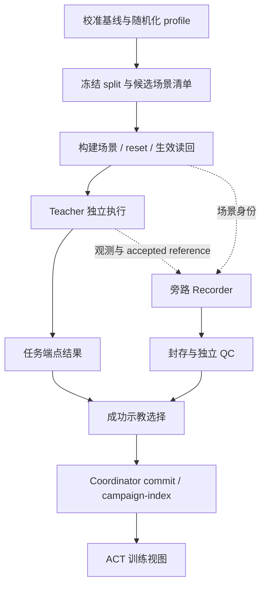

# SO-101 MuJoCo 环境随机化与 ACT 示教采集设计草案

日期：2026-10-09。状态：供用户审阅，未批准实施。目标已确认：优先迁移到当前 SO-101 实机，兼顾仿真泛化。“关机阻尼”按“关节阻尼”理解。

本文基于本地源码和现有设计进行静态分析，经过编写者 inline self review；未启动仿真、采集、训练或硬件动作。参数范围是试验起点，不是实机标定结果。远端 ACT 实现与运行资格未在本轮核验。

## 1. 推荐路线与取舍

采用“实机基线校准 → 单因素随机化 → 组合随机化 → 分层采集 → 冻结场景评估”。先把当前相机、机械臂、杯子和桌面的主要特性建对，再覆盖测量误差、安装变化、光照变化及舵机响应波动。

| 路线 | 收益与代价 | 本次选择 |
| --- | --- | --- |
| 实机校准后的 MuJoCo 分层随机化 | 可复用现有 MoveIt Teacher、ROS controller、Recorder；参数与失败原因可追溯 | 推荐 |
| 仅对已有 RGB 做颜色/背景增强 | 成本低，但不能生成新的接触响应、相机视差和受扰后的专家动作 | 作为训练侧补充 |
| 接入另一套写实渲染或仿真平台 | 可能改善特定成像效果，但增加资产、同步、控制和数据链路验证成本 | 暂不纳入首版 |

首版保留当前杯形、机器人运动学、抓取任务和固定放置目标。杯子尺寸、可碰撞杂物及目标位置变化分别后置；它们会同时影响规划、可达域或任务可观测性，不能当作纯视觉随机化。

## 2. 本地现状与设计前提

本地基线为 `main@7a62d8e88f4b04fa5f20359649013a16bae909b0`，依赖子模块为 `5a590b22770b270b71ba6a1c3443d4e67edc7f4b`。已有 ACT 文档的未提交修订是本轮读取的设计输入；本文不覆盖这些文件。

| 已核对的源码事实 | 对设计的影响 |
| --- | --- |
| [scene.xml](../../../src/so101_demo_py/assets/mujoco/scene.xml) 有单盏主光、task_camera、固定桌面和橙色杯；杯质量 `0.020 kg`，自由关节 `damping=1.0` | 先审计杯子阻尼与落体/滑移行为，不围绕未经测量的数值盲目扩大分布 |
| [so101.xml](../../../src/so101_demo_py/assets/mujoco/so101.xml) 默认关节 `damping=0.60`、`frictionloss=0.052`、`armature=0.028`；指垫滑动摩擦 `3.0`；位置执行器配置 `kp`、`kv` 和力限幅 | 分别建模被动阻尼、干摩擦、伺服响应和饱和，不用一个“电机噪声”参数代替 |
| [ResetWorld 实现](../../../third_party/mujoco_ros2_control/mujoco_ros2_control/src/mujoco_simulation.cpp) 支持 joint/free-joint state overrides | 可复用状态重置；环境模型参数事务还需设计实现 |
| [CameraPlugin](../../../third_party/mujoco_ros2_control/mujoco_ros2_control_plugins/src/camera_plugin.cpp) 由 `fovy` 推导等焦距、居中主点，畸变系数为零 | 内参随机化必须同时验证实际投影和 CameraInfo，不能只改消息或 XML |
| [控制接口](../../../third_party/mujoco_ros2_control/mujoco_ros2_control/src/mujoco_system_interface.cpp) 将位置目标写入 `ctrl`，随后允许插件更新控制快照 | 可评估在 plant 输入边界增加延迟/偏置模型；线程、更新周期和最终生效点仍需运行验证 |

head/wrist RGB、8D state 和 6D action 是[现有 ACT 设计合同](2026-09-10-so101-act-head-wrist-rgb-design.md)，不是本轮确认已运行的本地功能。实施前须核对执行机实际 checkout、安装产物及当前采集资格。

Teacher 与采集侧的权限以[2026-10-05 分离修订](2026-10-05-so101-teacher-act-decoupling-amendment.md)为准。Recorder、QC、数据提交失败不能取消、暂停、重置 Teacher。新随机化方案也不重新引入过程质量停机条件。

## 3. 实机校准先解决什么

设计阶段只列测量需求，不执行硬件动作。后续涉及机械臂动作的测量另行授权并遵守急停、限速及净空要求。

1. 相机：真实 head/wrist 的分辨率、有效帧率、内参、畸变、安装变换，以及曝光/白平衡设置。确认实机是否具备设计中的 neck yaw；缺失时显式修订 8D state 合同，不能伪造传感状态。
2. 视觉：同一桌面在常见光照下的图像、杯与指垫材质、桌面纹理；实机是否使用仿真里的红色落点标记。
3. 接触：杯质量/尺寸、桌面滑移、指垫夹持滑移及释放后运动。单独确认自由杯阻尼是否只是历史数值稳定补偿。
4. 舵机：各关节在几种姿态和负载下的目标/反馈响应、延迟、稳态误差、饱和及重复定位误差。区分控制器设定、机械摩擦与编码器误差，避免重复补偿。

拟合参数不必唯一，但必须能预测留出的实机响应。真实参数仍不足时保留 `uncalibrated` profile；可以做仿真探索，不能据此宣称 sim-to-real 已通过。

## 4. 随机化范围与时间尺度

下表给出小批预试验的建议包络。取得实机测量后，以测量分布替换；首版主要采用有界、以 nominal 为中心的分布，保留 nominal 样本。参数不能全部独立均匀抽样。

| 类别 | 首轮建议范围 | 约束及采样频率 |
| --- | --- | --- |
| 光照 | 主光强度 nominal 的 `0.7–1.3`；方位变化约 `±20°`；有限的明暗/偏暖/偏冷 profile | 每 episode 固定；RGB 光源参数不冒充实测色温或照度 |
| 桌面与背景 | 实机照片或接近实机的纹理资产库；杯子有限颜色/反光变化 | 每 episode 固定，素材按身份划分训练/测试；首版排除透明、镜面杯 |
| head 安装外参 | 平移各轴 `±10 mm`、小角度旋转各轴 `±2°` | 在安装坐标系采样；与 neck 运动的动态变换分开 |
| wrist 安装外参 | 平移各轴 `±3 mm`、旋转各轴 `±2°` | 固定在腕部刚体上，整段保持安装偏差；不在 world 中随意平移 |
| 相机内参 | 焦距相对变化 `±3%`；主点偏移各轴不超过对应图像尺寸的 `1%` | 第一阶段可仅支持一致的 FOV 变化；独立 fx/fy、主点、畸变须先通过投影测试 |
| 成像变化 | 有限曝光、白平衡和轻噪声；强度由实拍残差确定 | 常量或缓慢变化，避免逐帧独立剧变；模糊按运动/曝光建模 |
| 杯起点/机器人初态 | 已通过可达性与碰撞检查的区域内分层采样 | 每 episode；保持完整任务可执行，拒绝原因进入统计 |
| 接触摩擦 | 分别对杯–桌、杯–指垫的标定有效滑动摩擦取 `0.8–1.2×` | 每 episode 固定；扭转/滚动摩擦首轮固定 |
| 关节阻尼、干摩擦 | 各关节标定值 `0.8–1.2×`，非负、有绝对上下界 | 每 episode 固定；nominal 为零时使用测得绝对范围 |
| 杯质量 | 同一几何下 `0.9–1.1×` 标定质量 | 质量与惯量一致缩放；不模拟液体晃动 |
| 执行器响应 | 先对已校准 kp/kv 组合及力矩上限做约 `±10%` 变化 | 增益联动采样，保留原有关节/力矩/速度保护 |
| 电机偏置与延迟 | 预试验可探索偏置 `±0.3°`、额外延迟 `0–20 ms` | 只是待验证的探索上限；确认基线已有延迟，避免重复添加；夹爪单独标定 |

背景装饰只能放在工作空间之外，或作为纯远景。进入抓取区域的物体必须有一致的视觉、碰撞和 Planning Scene 表达。首版不加入与目标杯难以区分的第二只杯，因为当前 ACT 没有语言条件目标选择能力。

红色落点环需要专门处理：若实机没有该标记，训练数据应包含与实机一致的无环场景，目标仍保持基座坐标系中的固定位置。若以后随机放置目标，必须让目标通过真实可见标记或显式目标条件被策略观察到；不能只随机隐藏的奖励坐标。

## 5. 动力学和相机的生效边界

MuJoCo 的接触摩擦由两侧 geom、priority 或显式 pair 共同决定。同优先级通常按分量取最大值，所以只把杯子摩擦降低，未必能改变与高摩擦指垫的有效接触。随机化器必须按接触对设计配置，并审计实际接触系数与滑移响应。参见 [MuJoCo contact parameters](https://mujoco.readthedocs.io/en/stable/modeling.html#contact-parameters)。

“电机漂移”分三条通道：执行器目标零偏/缓慢漂移、编码器反馈零偏/噪声、增益与输出能力变化。首版先做执行器目标偏置和延迟，反馈通道后置；反馈偏置若启用，Teacher 和 ACT 读取相同语义的反馈，真值只供审计。

建议的 plant 输入模型为 `u_applied(t) = clip(u_reference(t - delay) + bias + drift(t))`。bias 每 episode 采样；drift 使用有界、低频、时间相关过程。限幅使用既有物理限制。复位必须清空延迟队列、漂移状态和历史命令；停止由执行安全路径优先处理，不能继续排放旧队列。

action 标签仍是策略/Teacher 在控制接口发出的已接受 reference，不是加偏置后的 plant 输入，也不是下一帧实际关节角。两者分开存档，部署和采集使用同一接口定义。延迟应模拟 reference 之后的执行链路，不能通过改写标签时间掩盖延迟。

物理相机参数变化时，渲染投影、CameraInfo、光学 TF 和 frame 身份必须一致；畸变需在图像形成链路实际施加。标定误差试验另设 profile，明确区分物理真值与发布的估计标定，不能让一次普通外参随机化无意变成错误 TF 试验。仅调整 viewer camera 不算传感器相机随机化。

模型修改采用 XML/受支持的模型编辑 API 编译为起点。质量/惯量等运行时修改涉及派生量，纹理更新涉及 GPU 上传；不能假定赋值后调用一次 forward 就全部生效。运行时快路径逐字段验证后才能启用，见 [MuJoCo model changes](https://mujoco.readthedocs.io/en/stable/programming/simulation.html#model-changes)。文档描述能力须再与执行机安装版本核对。

## 6. 接入现有流程

新增概念组件放入现有领域/应用/adapter 分层，名称待实施计划冻结，不在本轮创建代码：

| 组件 | 职责 |
| --- | --- |
| RandomizationProfile | 版本化参数、单位、分布、相关性、范围、资产白名单与校准来源 |
| ScenarioSampler | 按冻结 split 和种子生成候选；先分配场景族，再生成变体 |
| SceneRealizer | 从 nominal 模型构建本次环境，管理模型/渲染/控制配置应用及读回 |
| AppliedSceneManifest | 保存请求值、实际生效值、模型/资产哈希、软件版本、种子和 reset generation |
| 现有 Teacher / Recorder / QC | Teacher 执行；Recorder 旁路记录；独立 QC 筛选数据，沿用现有封存和提交链 |

首轮优先以完整模型构建和 `FULL_RESTART` 建立正确性基准，测出成本后再增加 `RESET_WORLD` 快路径。不得直接声称现有 reset 服务支持完整随机化。快路径须在仿真停止、控制所有权明确时恢复 nominal，再应用新配置；禁止在上一 episode 已随机化的数值上继续乘系数。

生效确认包含模型值、相机首个新 generation 的有效图像及标定、实际初始姿态。跨 reset 的相机缓存、controller reference 和扰动队列全部失效。失败发生在启动运动之前时拒绝该场景；一旦 Teacher 已执行，纯数据问题只能标为数据无效。Recorder readiness 不能成为 Teacher 运动许可。

纯视觉参数变化通常不要求修改运动规划；任何几何变化都需同步规划碰撞体。候选预检只覆盖合法配置、可达性与必要碰撞安全，不要求提前成功抓放来筛掉困难样本。真实失败保留并按参数分桶，防止采集分布只剩“容易成功”的场景。

物理光照、材质和背景变化也会影响 Teacher 的 task_camera 感知。分别记录 Teacher 感知失败与执行失败；不能暗中给 Teacher 保留另一套理想世界图像。若以后引入真值 Teacher，必须单独标记来源并评估示教分布变化，不与当前相机 Teacher 无标记混用。

## 7. ACT 数据与采样策略

沿用当前约定：head/wrist RGB `640×480`、10 Hz 仿真时间网格；state 为 `[q1..q6, sin(neck_yaw), cos(neck_yaw)]`；action 是 6D 绝对关节目标。`action[k]` 对齐 `t_k + 0.1 s` 的 accepted/executing controller reference。相机、状态以因果方式对齐，不能使用未来反馈补当前输入。搜索阶段与手臂 ACT episode 的边界遵循现有设计。

随机化参数、CameraInfo、真值、接触、Teacher 阶段、实际 plant 输入只存审计侧，不进入 ACT observation。训练归一化仅使用 Train。保留原始无损 PNG/JSONL；训练侧颜色增强另存配置和种子，不覆盖原始图像。若模拟物理成像效应，其输出作为策略观测，同时保留生成配方；不能以人为制造缺帧来绕过当前连续性合同。

每个 episode 绑定 `scenario_id`、`scene_family_id`、split、master seed/子种子、profile 版本与 hash、实际参数、资产 hash、base/model hash、控制及相机配置、软件版本、reset generation、Teacher 来源、执行结果及 QC 结果。随机流按几何/视觉/动力学/传感器分开派生，线程调度和 worker 数不能改变场景。支持按 manifest 重建；跨平台不承诺图像或浮点轨迹逐字节相同。

五集合继续为 Train、Validation、Offline Test、Rollout Validation、封存 Rollout Test。按空间区块、底层场景族、背景资产身份及相机安装 profile 分组；同一轨迹的重渲染/增强变体必须留在同一 split。测试另外留出未见参数组合和较宽包络，分别报告插值泛化与域外泛化。

第一轮建议约 100 条候选做数据链路和覆盖率检查；通过后以约 1,000 条合格训练示教为预算起点，按约 `20% nominal / 30% visual / 20% dynamics / 30% combined` 分层。具体候选配额在实测 Teacher 产出率后冻结，数量不构成训练充分性的保证。Validation 和 Offline Test 独立配额，rollout 集不进入专家采集队列。

新增数据仍从真实 Coordinator journal/index 导出，不能扫描目录自动拼接。若困难桶配额不足，报告 `QUOTA_UNSATISFIED` 和失败分布；不能复制数据、扩大阈值或悄悄缩窄随机范围补齐。补采使用新清单/数据身份。分别报告合法候选数、开始执行数、Teacher 成功数、QC 合格数与可提交数。

两个 RGB 相机每帧对的原始像素量为 `640×480×3×2 = 1,843,200 bytes`。按 10 Hz、60 s 估算，每条 episode 未压缩约 `1.11 GB`，1,000 条约 `1.11 TB`，尚未计其他证据。PNG 实际大小与吞吐须实测；不能用示意压缩比做磁盘准入依据。资产按 hash 复用，单条保存完整解析配置。

## 8. 分期与验收

| 阶段 | 交付内容 | 放行证据 |
| --- | --- | --- |
| A 基线 | 相机/接触/执行器校准 profile，当前 Teacher/Recorder 运行基线 | 留出测量可预测；基线抓放及数据链路可回读；明确未测参数 |
| B 视觉 | 光照、材质、相机安装与已支持的内参变化 | 实际 head/wrist 新图像、投影一致性、同 seed 重建、跨 episode 恢复 |
| C 动力学 | 接触对摩擦、阻尼、质量、执行器偏置/延迟 | 实际参数读回及响应变化；停止/reset 不残留旧命令；单因素边界试验 |
| D 组合采集 | 冻结 profile、split、场景清单及成功示教导出 | 约 100 候选预试验；Teacher/QC 独立；失败分桶及真实 index 回读 |
| E 训练评估 | 等量数据的 nominal、visual、dynamics、combined 四组 ACT 对照 | 同模型/训练预算/种子集合，统一未见 rollout 场景、置信区间和实机留出任务 |

E 是后续研究验收设计，不是本轮启动训练的授权。建议学习曲线先比较 250/500/1,000 条示教；四组对照应匹配初始任务分布和有效训练预算。记录扰动强度与各桶成功率，防止“总分提高”掩盖某个部署条件退化。强扰动下若标准 ACT 难以从当前观测推断隐含动力学，先收窄到测得范围，再评估是否需要历史状态或策略结构变化；这属于后续独立设计。

策略评估区分端点转移与直立成功、过程诊断、必要安全停止及控制故障；沿用冻结的端点结果版本，不把接触连续性重新加入 Teacher 任务成功门槛。Teacher 成功率分母是已开始的合法 attempts，数据合格率单列。

rollout 测试建议每个条件桶先保留至少 50 个独立场景，报告样本数及二项置信区间；实机以同组起点和光照做成对比较。绝对成功率目标、允许退化幅度和实机次数由基线测量后冻结，正式比较前不得再根据结果调整。本设计不预先保证提升或实机迁移成功。

实现测试重点是：seed/manifest 确定性、split 无泄漏、nominal 恢复、实际接触参数生效、投影一致性、action 标签未被 plant 扰动污染、停止/reset 清队列、Recorder 故障无反向控制。完整普通测试按各包 xdist 门禁执行；本任务不触发 perception benchmark suite。可见变化须取 fresh sensor 图像，不能只看 XML 或 viewer。

## 9. 实施范围、审阅与证据

拟修改范围为 `so101_demo_py` 的场景/profile、采样与 manifest、现有采集 adapter；CameraPlugin 投影/标定与控制扰动接入可能涉及 `third_party/mujoco_ros2_control`。依赖改动须独立记录来源并更新 lock。实施前在执行机核对 ACT 当前代码归属，避免凭本地设计文件创建第二套采集系统。

本轮 self review 已检查：Teacher/Recorder 权限边界、未来 reference 与 observation 因果性、有效摩擦而非单个 geom 值、固定目标的可观测性、模型更新与 reset 生命周期、训练/测试隔离、未校准范围的标记。尚无运行资格结论。

当前设计取证唯一根为 `/tmp/so101-debug-domain-randomization-design-20261009-01a11f59/`，登记在其 `manifest.md`。retained：本设计及该根；archived：无；deletion candidates：无。未删除证据。未来执行任务须另行登记其唯一持久根：ai-station 为 `/data/work/so101-evidence/<task-family>/<run-id>/`，macOS 为 `/opt/data/work/so101-evidence/<task-family>/<run-id>/`。

下一步是审阅此草案并冻结实机配置、首版参数集合和采集预算，然后编写实施计划。执行计划仍按 AGENTS.md 取得明确确认后，由 tmux 中的 `dst` 执行；本轮未启动执行器、未 commit/push。
